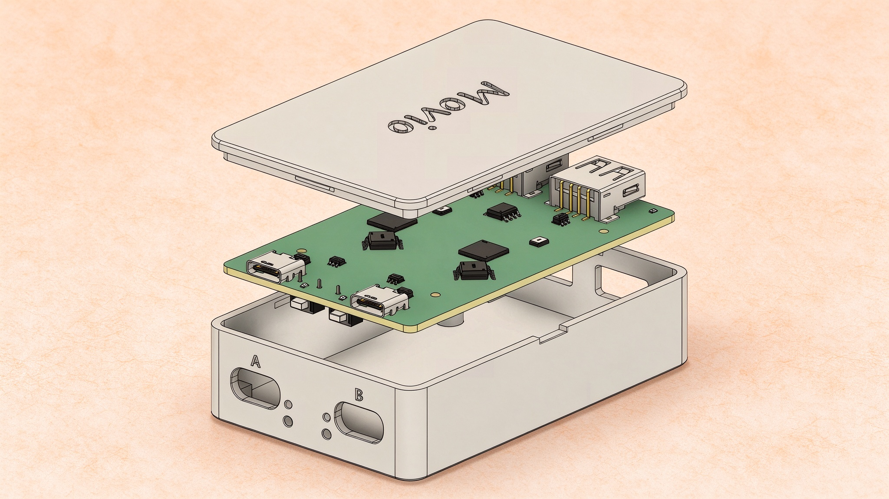
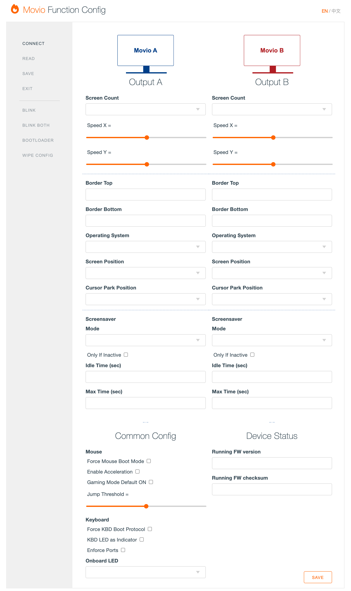

# Movio — One Keyboard and Mouse for Two Computers

**English** · [简体中文](README_zh.md)

Movio is an open-source hardware KVM-style switch that lets a single keyboard and mouse control two computers. Move the pointer across the shared edge of the screen and the cursor continues onto the other computer; the keyboard follows automatically. Both computers see a standard USB HID keyboard and mouse, so nothing needs to be installed and switching does not re-enumerate the devices.

Movio is a fork of [DeskHop](https://github.com/hrvach/deskhop) with a redesigned bilingual web configuration page, firmware stability fixes, smoother mouse behavior and a one-command build system. It is **not a video KVM**: monitors, speakers, cameras and USB storage stay connected to their own computers, and no data crosses between them.

> **Firmware v0.80** · This README summarizes the official [Movio product manual](Movio_产品说明书.docx) (Chinese, DOCX), which remains the authoritative reference for installation, configuration and safety.



## Contents

1. [Overview](#1-overview)
2. [Key features](#2-key-features)
3. [How it works](#3-how-it-works)
4. [Movio vs DeskHop](#4-movio-vs-deskhop)
5. [Quick start](#5-quick-start)
6. [Keyboard shortcuts](#6-keyboard-shortcuts)
7. [Web configuration](#7-web-configuration)
8. [Firmware updates](#8-firmware-updates)
9. [Build from source](#9-build-from-source)
10. [Security, privacy and safety](#10-security-privacy-and-safety)
11. [Known limitations and compatibility](#11-known-limitations-and-compatibility)
12. [Troubleshooting](#12-troubleshooting)
13. [FAQ](#13-faq)
14. [Documentation and license](#14-documentation-and-license)

---

## 1. Overview

Movio sits between your keyboard/mouse and two computers. It keeps a USB connection to both computers at the same time and forwards input to whichever one is active. Switching feels instant because the computers never lose their HID devices — only the routing changes.

### At a glance

| Item | Detail |
|------|--------|
| Inputs | 1 × USB-A keyboard port, 1 × USB-A mouse port |
| Outputs | 2 × USB device ports (A and B), one per computer |
| Switching | Mouse edge crossing, `Left Ctrl + Caps Lock`, per-output lock |
| Screens | 1–3 per output, up to 6 in total |
| Isolation | 2 kV design isolation between outputs via a digital isolator |
| Configuration | Local WebHID page, Chinese/English, no network access |
| Firmware | v0.80, UF2 format, two RP2040 boards |
| Software | None on either computer |

### What Movio does — and does not do

| What it does | What it does not do |
|--------------|---------------------|
| Control two computers with one keyboard and mouse | Switch monitors, video signals or audio |
| Cross screens with the mouse; keyboard follows | Drag files, copy/paste or share a clipboard between computers |
| Remember each computer's keyboard LED state | Share microphones, cameras or USB storage |
| Support multi-monitor layouts and height calibration | Control computers over Wi-Fi, Bluetooth or a network |
| Provide gaming mode, slow mouse and switch lock | Charge a laptop or act as a USB charger |
| Configure locally through a web page | Bypass OS login, security policy or EDR |

---

## 2. Key features

| Feature | Description |
|---------|-------------|
| **Mouse screen crossing** | Move the cursor to the shared screen edge and keep going to switch computers — no button press needed. |
| **Keyboard follows** | The keyboard automatically follows the active output, and `Left Ctrl + Caps Lock` switches independently. |
| **Driver-free** | Standard USB HID on both sides; plug and play with no software to install. |
| **Cross-platform** | Windows, macOS, Linux and Android, including mixed setups. |
| **Multi-monitor** | Select 1–3 screens per output in the web UI; up to 6 screens in total. |
| **Physical isolation** | 2 kV design isolation between outputs; no cross-computer data channel. |
| **Local configuration** | The on-device `config.htm` page runs entirely locally and is available in Chinese and English. |
| **Hotkeys** | Gaming mode, slow mouse, switch lock, system lock and screensaver controls. |
| **Open source** | Open hardware, firmware and documentation; code is released under GPLv3. |

---

## 3. How it works

### 3.1 Architecture

Movio is built around two RP2040 microcontrollers, one per computer. The two chips communicate over UART through a digital isolator, while the keyboard and mouse are connected to the USB-A input ports. The signal path is simply: **keyboard/mouse → Movio → active computer**.

### 3.2 Mouse

The firmware converts relative mouse movement into absolute coordinates (0–32767) for the active computer. When the cursor reaches the shared edge and keeps moving toward the other computer, Movio keeps the Y coordinate (or scales it according to the calibration) and flips the X axis to the other side. The cursor appears at a similar height on the other screen and the active output changes at the same time.

### 3.3 Keyboard

Keyboard reports are sent only to the active output. Switching with the mouse also moves the keyboard; `Left Ctrl + Caps Lock` switches both independently. On every switch Movio releases all pressed keys so nothing gets "stuck" on the other computer, and it restores the keyboard LED state (Caps Lock, Num Lock, etc.) remembered for each computer.

### 3.4 Isolation

The two outputs are separated by a digital isolator, so there is no electrical path between the computers. Movio provides no copy/paste, file transfer, clipboard sharing or any other cross-computer data channel, and LED reports coming from a computer are restricted to a strict single-byte output.

---

## 4. Movio vs DeskHop

Movio keeps DeskHop's core switching logic and dual-RP2040 architecture, and adds:

- **Chinese/English configuration UI** — full i18n with a language toggle in the top-right corner (defaults to Chinese).
- **Firmware stability fixes** — boundary checks, CRC32 type truncation, NKRO fallback and system report length checks.
- **Mouse behavior improvements** — smoother virtual-desktop switching, no cursor jumping with composite keyboards, and no stuck buttons when dragging on macOS.
- **LED management** — separate desired/actual LED states plus a 30 Hz synchronization task.
- **Build and documentation** — one-command build script, Chinese product manual and complete Chinese usage documentation.

See [Movio vs DeskHop](misc/Movio_vs_DeskHop.md) for the full comparison.

---

## 5. Quick start

This section takes you from unboxing to the first screen crossing in about ten minutes.

### 5.1 Before you start

- Movio running firmware **v0.80 or newer**. A brand-new board without firmware must be flashed first (see [Method 2](#84-method-2-bootsel-recoveryfirst-flash)).
- **Two USB data cables** that match the board's A/B device ports (USB-C or Micro-USB, depending on the hardware revision). Charge-only cables cannot establish a USB data connection.
- A **USB keyboard and mouse** — wired, or 2.4 GHz wireless with a USB receiver. Bluetooth-only peripherals have no receiver and cannot be used directly.
- **Two powered computers** that supply USB power. Most desktops and laptops provide USB power even when shut down, but both computers should be running.
- **Chrome, Chromium or Edge** for configuration. Firefox and Safari do not support the WebHID API used by the config page.

> **Important**
> The A and B sides are powered by their respective computers. With only one computer connected, the other side has no power and two-computer switching cannot work. If you only need a keyboard and mouse on a single computer, a plain USB hub is simpler. A 2.4 GHz receiver can be used with only one side powered, but the receiver must be plugged into the USB-A port on the same side as the powered USB device port.

### 5.2 Connect the hardware

The example below uses the default layout: **A on the right, B on the left**. Your physical arrangement can differ; set it later in the web UI.

1. **Connect the keyboard** to the USB-A port marked with the keyboard icon. For a wireless keyboard, plug its USB receiver into this port.
2. **Connect the mouse** to the USB-A port marked with the mouse icon. For a wireless mouse, plug its receiver here; a combined keyboard/mouse receiver usually works in either input port.
3. **Connect computer A** to the A device port with a USB data cable.
4. **Connect computer B** to the B device port with a second USB data cable.

| Port / part | Purpose |
|-------------|---------|
| Keyboard USB-A | USB keyboard, or the receiver of a 2.4 GHz wireless keyboard |
| Mouse USB-A | USB mouse, or the receiver of a 2.4 GHz wireless mouse |
| A device port | Connects to computer A |
| B device port | Connects to computer B |
| BOOTSEL button ×2 | Hold while plugging in that side's USB port to enter RPI-RP2 bootloader mode for recovery |
| Onboard status LED ×2 | Active output, configuration mode or firmware write status |
| Onboard power LED ×2 | Power presence on that side |

Both USB-A ports can auto-detect a keyboard or mouse, so swapping them usually still works. For best compatibility, however, follow the icons. If **Enforce Ports** is enabled, the keyboard must be on the A side and the mouse on the B side.

> **Warning**
> Never plug a computer into a USB-A input, and never plug a keyboard or mouse into an A/B output. With the ports reversed, the computer may not recognize Movio and the peripherals will not respond. Configuration mode starts only on the side where the keyboard is connected — look for the MOVIO drive on that computer.

### 5.3 Power-on and LED feedback

After both computers are connected, Movio powers up immediately. Wait about 5–10 seconds for USB enumeration. Both computers should see a standard USB HID keyboard and mouse; no driver, disk or network device is expected.

When a keyboard or mouse is plugged in, the onboard and keyboard LEDs usually blink quickly 2–3 times to confirm detection. During normal use, the onboard LED of the active output stays lit (default **Active output** LED mode).

| LED behavior | Meaning | Action |
|--------------|---------|--------|
| Quick blink 2–3 times after plugging in a device | Device detected | Normal, continue |
| Onboard LED of the active output stays lit | Normal standby, shows the active output | None |
| Onboard LED blinks periodically | Device is in configuration mode | Open the MOVIO drive, or wait for auto-exit |
| Onboard LED blinks rapidly and continuously | Firmware is being written or synchronized | Keep power and USB connected; do not unplug |
| No LEDs at all | No power, LEDs disabled, or device not booting | Check both computers, cables and the LED mode |

If the case hides the onboard LEDs, enable **KBD LED as Indicator** or use the **Blink / Double Blink** buttons on the config page to identify the device.

### 5.4 First screen crossing

On first power-up the active output is **A**, and the default layout is **A on the right, B on the left**. Move the cursor to the left edge of A's screen and keep moving left; it crosses to B. Move right from B's right edge to return to A.

The keyboard follows automatically: whichever computer shows the cursor receives keyboard input. You can also press `Left Ctrl + Caps Lock` at any time to switch both keyboard and mouse.

| Actual layout | From A to B | From B to A |
|---------------|-------------|-------------|
| A right, B left (default) | Move the cursor left across the shared edge | Move the cursor right across the shared edge |
| A left, B right | Move the cursor right across the shared edge | Move the cursor left across the shared edge |

If the cursor reaches the edge but does not switch, check in this order: the **Screen Position** setting matches the real layout; **Jump Threshold** is not too high; gaming mode or switch lock is not active; no mouse button is being held; the cursor is on the main screen (screen 1).

> **Tip**
> For the first switch, park the cursor at the vertical middle of A's screen and push slowly across the edge — this makes it easy to see whether the Y coordinate is preserved. After switching to B, type a few characters to confirm the keyboard followed, then move back to A and confirm it switched back.

### 5.5 Minimum configuration

The factory defaults are only a common example: output A is macOS on the right, output B is Linux on the left. If your operating systems or physical layout differ, you must change the configuration — otherwise switching direction may be reversed and **Lock Both Computers** may send the wrong shortcut.

1. **Enter configuration mode** — with the keyboard connected and the device in normal mode, hold `Left Ctrl` and `Right Shift`, then press `C` and `O` in sequence. The device restarts and the computer connected to the keyboard gets a USB drive named **MOVIO**.
2. **Open the config page** — open `config.htm` from the MOVIO drive in Chrome, Chromium or Edge. Do not use Firefox or Safari.
3. **Connect** — click **Connect** on the left, select Movio in the browser dialog and allow access. The page reads the current configuration automatically; if not, click **Read**.
4. **Set both computers** — in the **Output A** and **Output B** sections, set the operating system, screen position and screen count to match your actual setup. Leave the other options at their defaults for now.
5. **Save and exit** — click **Save** and wait for **Done**, then click **Exit**. The MOVIO drive disappears and the device returns to normal mode.

| Setting | Output A example | Output B example | Notes |
|---------|------------------|------------------|-------|
| Operating System | Windows | Linux | Must match the real OS; affects system-lock shortcuts and multi-screen compatibility. |
| Screen Position | Right | Left | The computer's position in the overall layout, not the main screen's position within the computer. |
| Screen Count | 1 | 1 | Use 1 for a single monitor; for multiple monitors, the main screen should be adjacent to the other computer. |
| Other options | Default | Default | Adjust speed, borders, screensaver, etc. after basic switching works. |

Changes are sent to the device immediately, but only **Save** writes them to flash. Configuration mode exits automatically after about 5 minutes of inactivity, and unsaved changes are lost.

### 5.6 Calibrate screen height

If the two monitors differ in size, resolution or vertical position, the cursor may appear at a different height after switching. Calibrate the height so it lands at a similar position on the other screen. If both monitors are identical and aligned, you can skip this section.

1. **Switch to the larger screen** — move the cursor to the computer with the larger monitor.
2. **Align the top edge** — park the cursor at the height corresponding to the smaller screen's top edge and hold it still.
3. **Record the top border** — press `Right Shift + F12 + Y`. The onboard and keyboard LEDs blink to confirm, and the current height is stored as the top border.
4. **Record the bottom border** — move the cursor to the height of the smaller screen's bottom edge and press `Right Shift + F12 + Y` again.
5. **Verify** — switch back and forth a few times; if the height still differs, repeat the calibration or fine-tune the borders in the web UI.


Calibration is saved to the flash of both RP2040 boards and takes effect on both. The shortcut records the top border when the cursor is in the upper half of the screen and the bottom border when it is in the lower half. To undo a bad calibration, set the top/bottom borders back to 0 and 32767 in the web UI, or use **Clear Config**. Re-calibrate after changing monitors or their positions.

---

## 6. Keyboard shortcuts

All shortcuts are handled by Movio itself and require no driver. Key names refer to physical keys: left and right Ctrl/Shift are different keys and cannot be swapped. The `+` means "hold both"; for a longer sequence such as `Left Ctrl + Right Shift + C + O`, hold the modifiers and press the letter keys in order.

Some membrane keyboards cannot report several keys at once (ghosting), so a combination may not trigger. Slow down the sequence or use a keyboard with 6KRO/NKRO support. Except for slow mouse, the shortcuts below are intercepted by Movio and are **not** sent to the computer; an application that uses the same combination will not receive it.

### 6.1 Configuration shortcuts

| Action | Shortcut | Description |
|--------|----------|-------------|
| Enter/exit configuration mode | `Left Ctrl` + `Right Shift` + `C` + `O` | The device restarts and a MOVIO drive appears on the keyboard's computer; press again in config mode to exit. |
| Reset configuration | `Right Shift` + `F12` + `D` | Immediately erases both RP2040 configurations and restores defaults — no confirmation. |
| Save screen height offset | `Right Shift` + `F12` + `Y` | Records the current cursor height as the top or bottom border and saves it to flash. |

### 6.2 Usage shortcuts

| Action | Shortcut | Description |
|--------|----------|-------------|
| Switch output | `Left Ctrl` + `Caps Lock` | Moves keyboard and mouse to the other computer; affected by switch lock. |
| Gaming mode | `Left Ctrl` + `Right Shift` + `G` | Switches the mouse to relative mode; the cursor no longer crosses at the edge. Keyboard shortcuts still switch output unless switch lock is also on. |
| Screensaver: Pong | `Left Ctrl` + `Right Shift` + `S` | Enables Pong mode on the active output; temporary, not written to flash. |
| Screensaver: Jitter | `Left Ctrl` + `Right Shift` + `J` | Enables Jitter mode on the active output; temporary, not written to flash. |
| Disable screensaver | `Left Ctrl` + `Right Shift` + `X` | Disables the screensaver on the active output; temporary. |
| Slow mouse | `Right Ctrl` + `Right Alt` | Reduces mouse speed to about 1/4 for precise positioning; press again to restore. |
| Switch lock | `Right Ctrl` + `K` | Blocks edge crossing and hotkey switching; press again to unlock; cleared on reboot. |
| Lock both computers | `Right Ctrl` + `L` | Sends the OS lock shortcut to both computers; requires the correct OS setting first. |

> The shortcuts cannot be changed in the web UI. To customize them, redefine `HOTKEY_MODIFIER`, `HOTKEY_TOGGLE` and related macros in [`src/include/user_config.h`](src/include/user_config.h), then rebuild the firmware.

### 6.3 The two kinds of lock

| Function | Shortcut | Effect | Persistent |
|----------|----------|--------|------------|
| Switch lock | `Right Ctrl` + `K` | Prevents edge crossing and hotkey switching, avoiding accidental switches. | No, cleared on reboot |
| Lock both computers | `Right Ctrl` + `L` | Sends the system lock shortcut to both computers, locking their OS sessions. | No, one-shot action |

"Lock both computers" depends on the OS configured for each output: Windows sends `Win + L`, Linux sends `Super + L`, macOS sends `Ctrl + Cmd + Q`. An incorrect OS setting produces the wrong shortcut. Some Linux desktop environments use a different lock shortcut and may not respond. This action locks the computers; it does not prevent you from switching outputs afterwards.

### 6.4 Feedback and key conflicts

- **Feedback:** most shortcuts make the onboard and keyboard LEDs blink quickly for about 0.4 seconds (2–3 times). In configuration mode the LEDs blink periodically until you exit.
- **Firmware writes:** the onboard LED blinks continuously during an upgrade; the keyboard LED is not guaranteed to be in sync.
- **Key conflicts:** keyboards that cannot report multiple keys may fail to trigger a combination. Prefer a 6KRO/NKRO keyboard, or press the keys more slowly.
- **Application conflicts:** shortcuts are consumed by Movio and never reach the OS; an application using the same combination will not receive it.
- **Caps Lock:** pressing Caps Lock alone still works normally. It is treated as a switch shortcut only when held together with Left Ctrl.
- **Slow mouse caveat:** unlike the other shortcuts, the slow-mouse combination passes the Ctrl and Alt modifiers to the operating system, so some applications may also see `Ctrl+Alt`. If that conflicts, lower **Speed X / Speed Y** instead.

---

## 7. Web configuration

The configuration page is a completely local WebHID page. It needs no internet connection, loads no external scripts and reads/writes settings directly on the device.

### 7.1 Entering configuration mode

1. **Enter configuration mode** — with the keyboard connected and the device in normal mode, press `Left Ctrl + Right Shift + C + O`. After the restart, a **MOVIO** drive appears on the keyboard's computer.
2. **Open the page** — double-click `config.htm` on the MOVIO drive. It is a self-extracting local HTML file that expands when opened in a browser; do not open it in a text editor.
3. **Connect the device** — click **Connect** on the left, select Movio in the browser dialog and allow access. The page reads the configuration automatically; if it does not, click **Read**.
4. **Change and save** — adjust the settings for your setup. Changes are sent immediately, but only **Save** writes them to flash. Click **Exit** when done; the device restarts in normal mode.

The page runs entirely locally, loads no external JavaScript and uploads no configuration data. WebHID access requires explicit user authorization, and the vendor HID interface is exposed only in configuration mode. Configuration mode exits automatically after about 5 minutes of inactivity.

### 7.2 Page layout and buttons

The page has five areas: the brand and language switch at the top, the action menu on the left, the **Output A / Output B** columns, the common settings below, and the device status plus Save button at the bottom right. Output B mirrors Output A exactly. The **EN / 中文** switch in the top-right corner stores the choice in browser local storage; the default is Chinese. Buttons usually show **✓ Executed** briefly, and a successful save shows a green **Done** on the Save button.



| Button | Purpose | Notes |
|--------|---------|-------|
| Connect | Connect to Movio over WebHID | Required after the first load or a page refresh. |
| Read | Read all current settings from the device | Click again after saving to confirm the values. |
| Save | Write the current settings to both RP2040 boards | Changes are not persisted automatically. |
| Exit | Restart the device and leave configuration mode | The MOVIO drive disappears. |
| Blink | Blink the onboard LED of the current board | Identifies the device; does not change settings. |
| Double Blink | Blink both RP2040 onboard LEDs together | Confirms that both boards are running. |
| Bootloader | Put both RP2040 boards into BOOTSEL mode | RPI-RP2 drives appear; keyboard and mouse stop working until reflashed. |
| Clear Config | Erase both configurations and restore defaults | No confirmation; all settings are lost. |

> **Caution**
> **Bootloader** and **Clear Config** take effect immediately. Do not use them unless you know exactly what you are doing.

### 7.3 Output A / Output B settings

The two outputs have identical fields. The defaults below come from the current firmware; values read from an already-configured device take precedence.

| Setting | Range / default | Description |
|---------|-----------------|-------------|
| Screen Count | 1 / 2 / 3 · default 1 | Number of monitors connected to this computer. The main screen should be adjacent to the other computer; extra screens extend outward. Linux usually works best with 1. |
| Speed X | 1–100 · default 16 | Horizontal mouse speed; higher is faster. Keep the default until basic switching works. |
| Speed Y | 1–100 · default 28 | Vertical mouse speed; higher is faster. |
| Border Top | 0–32767 · default 0 | Top calibration border; 0 is the top of the screen. Calibrate with `Right Shift + F12 + Y`. |
| Border Bottom | 0–32767 · default 32767 | Bottom calibration border; 32767 is the bottom of the screen. |
| Operating System | Linux / MacOS / Windows / Android / Other · A defaults to MacOS, B to Linux | Affects system-lock shortcuts and multi-screen compatibility. Must match the real OS. |
| Screen Position | Left / Right · A defaults to Right, B to Left | The computer's position in the overall layout, not the main screen's position inside the computer. |
| Cursor Park Position | Top / Bottom / Previous · default Top | Where the old cursor parks when crossing to another computer. "Top" is usually fine. |
| Screensaver Mode | Disabled / Pong / Jitter · default Disabled | Sends tiny mouse movements to prevent sleep or lock. |
| Only If Inactive | Checked / unchecked · default unchecked | Run the screensaver only when this output is not the active one. |
| Idle Time (sec) | Seconds · default 240 | Inactivity before the screensaver starts on this output. |
| Max Time (sec) | Seconds · default 0 (unlimited) | Maximum screensaver runtime; 0 means unlimited. |

The default OS and screen position are examples, not your actual setup. Change them on first use, otherwise switching may go the wrong way, multi-screen behavior may be wrong, or the system-lock shortcut may be incorrect.

**Screen position** describes where the computer sits in the overall desktop layout, not where its main screen sits within that computer. The default layout is A on the right and B on the left; if your physical setup is reversed, swap the two **Screen Position** values. Only side-by-side layouts are supported — vertical stacking is not.

**Multi-monitor:** each computer's main screen should be adjacent to the other computer, with extra screens extending away from the shared edge.

```text
B3 (extra) — B2 (extra) — B1 (main)  │  A1 (main) — A2 (extra) — A3 (extra)
```

Do not place an extended screen between the main screen and the other computer, or the switching logic will not match the visual layout. Windows and macOS use a compatibility mode for multi-screen; the cursor may feel slightly different from single-screen. Linux usually manages multiple monitors in the desktop environment, so setting **Screen Count** to 1 is recommended.

**Borders:** 0 is the top of the screen and 32767 the bottom. If both monitors are the same size, leave 0 / 32767. If they differ in size or vertical position, calibrating with `Right Shift + F12 + Y` is more reliable than typing values by hand. Click **Save** after editing borders manually.

### 7.4 Screensaver

The Movio "screensaver" is not a monitor screensaver. It sends very small mouse movements to prevent a computer from sleeping, locking or starting its own screensaver. It never clicks or sends keystrokes. This is especially useful for computers behind a dock that are hard to wake.

| Mode | Behavior | When to use |
|------|----------|-------------|
| Disabled | No automatic movement is sent. | Default; when you do not need to prevent locking. |
| Pong | The cursor bounces around the screen, updating about every 5 ms. | When the computer must stay active and cursor movement is acceptable. |
| Jitter | A tiny movement (about 2 coordinate units) roughly every 10 seconds. | When you want minimal disturbance and only need to prevent sleep. |

With **Only If Inactive** checked, the screensaver runs only when that output is not the active one. For example, while using A you can keep B awake by enabling its screensaver with **Only If Inactive** checked. **Idle Time** is how long the output must be idle before starting (default 240 seconds); **Max Time** is the maximum runtime, with 0 meaning unlimited.

The three screensaver hotkeys enable Pong, enable Jitter or disable the screensaver temporarily, but they do not write to flash. To make the setting persistent, configure and save it on the web page. Screensavers increase power consumption and may interfere with some full-screen applications, so use them only when needed.

### 7.5 Common settings

Common settings apply to the whole device, regardless of output A/B. Keep the defaults at first and adjust one option at a time after basic switching works.

| Setting | Default | Description |
|---------|---------|-------------|
| Force Mouse Boot Mode | Off | Initializes the mouse with the simple boot protocol to fix some compatibility issues. May lose advanced features; enable only if needed. |
| Enable Acceleration | On | Automatically accelerates based on mouse speed. Turn off for a linear feel or precise aiming. |
| Gaming Mode Default ON | Off | Boot directly into gaming mode (relative mouse, no edge crossing). Useful for games and virtual machines. |
| Jump Threshold | 0 | Extra distance required to cross to the other computer, range 0–3000. Higher values reduce accidental switches; 0 switches as soon as the edge is reached. |
| Force KBD Boot Protocol | Off | Initializes the keyboard with the boot protocol, improving BIOS/UEFI and BitLocker compatibility. May affect advanced key features. |
| KBD LED as Indicator | Off | Uses the Caps Lock LED to show the active output: lit = output B, off = output A. Overrides the normal Caps Lock meaning. |
| Enforce Ports | Off | Forces the keyboard onto the A side and the mouse onto the B side. Enable only if your wiring matches. |
| Onboard LED | Active output | Display mode: Active output / Short idle / Long idle / Status blinks only / Disabled. |

**Enable Acceleration** is on by default. The device scales movement based on speed, making slow movement more precise and fast movement quicker. If the cursor feels "floaty" or aiming is unstable, turn acceleration off for a linear response; speed is then controlled only by **Speed X/Y**.

**Jump Threshold** affects only cross-computer switching, not local moves between the main and extended screens of the same computer. 0 switches at the edge; if accidental switches are common, try 200–500; if switching is difficult, set it to 0. It is a common setting shared by both outputs.

**Force Mouse Boot Mode**, **Force KBD Boot Protocol** and **Enforce Ports** solve compatibility problems. They take effect after a reboot or after replugging the keyboard/mouse. They may cost advanced features, so leave them off if the device already works.

| Onboard LED mode | Behavior |
|------------------|----------|
| Active output (default) | The LED for the active output is lit; the other is off. |
| Short idle (1 second) | Lit while the active output has input; off about 1 second after input stops. |
| Long idle (2 minutes) | Lit while the active output has input; off about 2 minutes after input stops. |
| Status blinks only | Off normally; blinks only for status events such as USB detection, hotkey confirmation or configuration mode. |
| Disabled | Onboard LEDs are not used for status. |

If the case hides the onboard LEDs, enable **KBD LED as Indicator** to read the active output from the Caps Lock LED, or use **Blink / Double Blink** on the config page to locate the device. With the indicator enabled, Caps Lock no longer shows the Caps Lock state: lit = output B is active, off = output A is active. Num Lock and Scroll Lock still show their normal OS state.

### 7.6 Saving, applying and exiting

Input fields, drop-downs and sliders send values to the device as soon as they change, but only **Save** writes them to flash. Unsaved changes are lost when you exit configuration mode, restart or lose power.

| Change | Takes effect | Save required |
|--------|--------------|---------------|
| Speed X/Y, borders, jump threshold | Immediately | Yes, otherwise lost on reboot |
| Screensaver mode, idle/max time | Immediately | Yes |
| Onboard LED mode, KBD LED indicator | Immediately | Yes |
| Force Mouse Boot Mode | After reboot or replugging the mouse | Yes |
| Force KBD Boot Protocol | After reboot or replugging the keyboard | Yes |
| Enforce Ports | After reboot or replugging keyboard/mouse | Yes |
| Gaming Mode Default ON | After device reboot | Yes |
| Operating System, Screen Position, Screen Count | Immediately affects switching logic | Yes |

- **Save** writes the current settings to both RP2040 boards. The left-menu **Save** and the bottom-right **Save** do the same thing.
- **Exit** restarts the configuration-side board and removes the MOVIO drive.
- **Auto-exit** restarts after about 5 minutes without configuration activity; unsaved changes are lost.
- **Config hotkey again** — pressing `Left Ctrl + Right Shift + C + O` while in configuration mode also exits.
- **Read back** — after saving, click **Read** once more to confirm the device values were updated.

> **Tip**
> Movio does not currently support exporting or importing configuration. After the first setup, take a screenshot of the config page. Before a firmware upgrade, record the OS, screen position, screen count and border values so you can restore them quickly.

### 7.7 Linux permissions (udev)

On Linux, Chrome/Chromium may need a udev rule to access HID devices. In configuration mode the device ID is **2e8a:107c**, not the normal-mode **1209:c000**; if you only add the normal-mode rule, the config page may not see the device.

Create `/etc/udev/rules.d/99-movio.rules` with:

```udev
# Movio normal mode (optional)
KERNEL=="hidraw*", ATTRS{idVendor}=="1209", ATTRS{idProduct}=="c000", TAG+="uaccess"

# Movio configuration mode (required for WebHID)
KERNEL=="hidraw*", ATTRS{idVendor}=="2e8a", ATTRS{idProduct}=="107c", TAG+="uaccess"
```

Reload the rules and replug the device:

```shell
sudo udevadm control --reload-rules
sudo udevadm trigger
```

If your system does not support `uaccess`, use the `plugdev` group instead:

```udev
KERNEL=="hidraw*", ATTRS{idVendor}=="2e8a", ATTRS{idProduct}=="107c", GROUP="plugdev", MODE="0660"
```

```shell
sudo usermod -aG plugdev "$USER"
```

Log out and back in after changing groups. After replugging the device, confirm the ID with:

```shell
lsusb | grep -E "2e8a:107c|1209:c000"
```

| Mode | VID:PID | Description |
|------|---------|-------------|
| Normal mode | `1209:c000` | Standard HID keyboard and mouse. |
| Configuration mode | `2e8a:107c` | Includes the MOVIO virtual drive and vendor HID interface. |

Sandboxed browsers such as Flatpak or Snap builds may also need USB/HID device permissions; if in doubt, use the Chrome/Chromium package from your distribution.

### 7.8 Browser support

| Browser | WebHID | Notes |
|---------|--------|-------|
| Chrome | Yes | Recommended. |
| Chromium | Yes | Recommended. |
| Edge | Yes | Chromium-based, usually works. |
| Firefox | No | WebHID is not supported; the device cannot be configured. |
| Safari | No | WebHID is not supported. |
| Mobile browsers | Usually no | Configure from a computer. |

The `config.htm` file is self-extracting, so it may look like compressed code in a text editor. That is normal — always open it with a browser.

---

## 8. Firmware updates

Movio uses UF2 firmware. Both RP2040 chips are flashed with the **same** `movio.uf2` file; the A/B role is detected automatically, so there are no separate A and B builds.

### 8.1 Files and version rules

| Item | Description |
|------|-------------|
| Firmware file | `movio.uf2` — the same file for both RP2040 chips |
| Current version | v0.80 |
| Hardware | Two RP2040 chips on one PCB; connector type depends on the board revision |
| Integrity | CRC32 checksum to detect transfer/write errors; not a cryptographic signature |
| Configuration | The device restores defaults if the configuration structure version changes; check OS, screen position and screen count after upgrading |
| Methods | MOVIO virtual drive (recommended), BOOTSEL / RPI-RP2, config-page **Bootloader** |

Download firmware from [dl.acenova.tech](https://dl.acenova.tech) or the project [Releases](https://github.com/likeaturtle/Movio/releases). Only copy `.uf2` files to the MOVIO drive — `.elf`, `.bin` and other files are ignored. Do not use firmware from untrusted sources.

### 8.2 Before you update

- Keep **both computers powered on** and both A/B connections stable. The safest state is both computers running. During the update the second side is updated over the inter-board link and needs its own power.
- Use **reliable data cables**, preferably connected directly to the computers. Avoid unstable hubs, extension cables or underpowered ports.
- **Download and verify** the new `movio.uf2`; check the published checksum if one is provided.
- **Record the current configuration** — screenshot the config page and note the OS, screen position, screen count and border values.
- **Read the release notes** and keep a known-good older firmware in case you need to roll back.

> **Warning**
> Do not cut power, unplug USB, shut down the computers, format the MOVIO drive or force a reboot during an update. An interrupted write can corrupt the firmware and require BOOTSEL recovery ([Method 2](#84-method-2-bootsel-recoveryfirst-flash)). The onboard LED blinks while writing; the update is complete only when the blinking stops and the device re-enumerates.

### 8.3 Method 1: MOVIO drive (recommended)

This is the easiest method for a device that already runs Movio firmware. Copy the UF2 file to the MOVIO drive and the second RP2040 synchronizes automatically.

1. **Enter configuration mode** — keep both computers on and connected. Press `Left Ctrl + Right Shift + C + O`; after the restart, the MOVIO drive appears on the keyboard's computer.
2. **Confirm the drive** — open MOVIO and check that `config.htm` is in the root directory. If the drive is missing, recheck configuration mode and the keyboard side (see [5.5](#55-minimum-configuration)).
3. **Copy the firmware** — copy the new `movio.uf2` to the root of the MOVIO drive. The onboard LED blinks during the copy; this is normal.
4. **Wait for the write** — the current RP2040 writes the firmware and restarts, then synchronizes it to the other RP2040 over the inter-board link. LEDs on both boards may blink.
5. **Wait for the restart** — the upgrade is complete when both boards stop blinking and the device re-enumerates. Do not unplug or power off during this time.
6. **Verify the version** — re-enter configuration mode, connect the config page and check that both boards report the same firmware version in **Device Status**.

Only copy the firmware to one board. The other board detects the newer version and pulls the firmware over UART, so the update is most reliable when both computers are connected and powered. If only one computer is connected, the other side is unpowered and automatic synchronization cannot complete.

The MOVIO drive is a virtual drive provided by the firmware, not a normal USB stick. It only accepts UF2 data blocks and provides `config.htm`; do not use it for storage or format it.

### 8.4 Method 2: BOOTSEL (recovery/first flash)

Use the RP2040 ROM bootloader for a brand-new board, a failed upgrade, a device that will not boot, or a downgrade. Each RP2040 must be flashed separately.

1. **Disconnect everything** — unplug the keyboard, mouse and both computer cables, then reconnect only the USB device port of the board you are flashing to one computer. If the case covers the BOOTSEL button, open the case first.
2. **Hold BOOTSEL** — press and hold the BOOTSEL button for that board.
3. **Plug in USB** — connect that board's USB device port to the computer while still holding BOOTSEL, until an **RPI-RP2** drive appears.
4. **Release the button** — let go of BOOTSEL once RPI-RP2 is visible.
5. **Copy the firmware** — copy `movio.uf2` to the root of the RPI-RP2 drive.
6. **Wait for the restart** — the board restarts automatically and the RPI-RP2 drive disappears.
7. **Flash the other board** — repeat steps 2–6 for the second RP2040. Both use the same UF2 file; there is no A/B distinction.
8. **Reconnect** — reconnect the keyboard, mouse and both computers, then check the configuration as described in [Section 5](#5-quick-start).

The RP2040 ROM bootloader cannot be erased by firmware, so BOOTSEL recovery normally works as long as the hardware is intact. Configuration may be reset after recovery; set the OS, screen position and screen count again if needed.

| Situation | Recommended method | Notes |
|-----------|--------------------|-------|
| Brand-new board | BOOTSEL | A blank RP2040 has no Movio firmware, so no MOVIO drive appears. |
| Routine version upgrade | MOVIO drive | Easiest; the other RP2040 synchronizes automatically. |
| Failed upgrade / no boot | BOOTSEL | Flash both boards separately to the same version. |
| Downgrade | BOOTSEL | Automatic sync only upgrades; downgrades must be flashed manually on both boards. |
| Config page works but the drive is unreliable | Config-page **Bootloader** | Puts both boards into BOOTSEL, then copy the UF2 to each. |

### 8.5 Method 3: Bootloader button

If the device still enters configuration mode but the MOVIO-drive upgrade is unreliable, use **Bootloader** on the config page to put both RP2040 chips into BOOTSEL, then copy the firmware manually.

1. **Enter configuration mode** — press `Left Ctrl + Right Shift + C + O`, open `config.htm` and connect.
2. **Click Bootloader** — both boards restart into BOOTSEL and the keyboard/mouse stop working.
3. **Find RPI-RP2** — one or two RPI-RP2 drives may appear; if only one appears, flash it first, then handle the other board.
4. **Copy the firmware** — copy `movio.uf2` to each RPI-RP2 drive.
5. **Reconnect** — wait for the boards to restart, reconnect the peripherals and computers, and verify the version as described in [8.7](#87-after-upgrading).

> **Caution**
> Bootloader mode makes the keyboard and mouse unavailable until both boards are reflashed and restarted. Save your work before using it, and avoid doing this during a meeting, presentation or remote session.

### 8.6 Synchronization and version rules

The two RP2040 chips exchange their running versions over a UART heartbeat. If one board sees a newer version on the other, it pulls that firmware and writes it; an equal or older version does not trigger synchronization. Automatic sync therefore **only upgrades, never downgrades**.

- **Same file:** both boards use the same `movio.uf2`; the A/B role is detected in hardware, so no separate builds are needed.
- **Upgrade only:** automatic sync is triggered by a newer version on the peer. To downgrade, flash both boards with BOOTSEL.
- **Configuration compatibility:** if the configuration structure version changes, the device restores defaults. Check OS, screen position and screen count after upgrading.
- **Integrity:** CRC32 is verified after writing. If verification fails, the device may enter bootloader mode and need BOOTSEL recovery.
- **High-security setups:** cross-chip upgrades can be disabled at build time with `DISABLE_FW_UPGRADE`. This is not recommended for normal users.

If only one board was updated, keep both computers connected and wait for the heartbeat to trigger synchronization. If it still does not complete, flash both boards to the same version with BOOTSEL. Do not run mismatched versions long-term; behavior may be inconsistent.

### 8.7 After upgrading

1. **Check the version** — enter configuration mode and look at **Device Status**; both boards should report the same version and checksum.
2. **Check the configuration** — confirm that OS, screen position, screen count and borders still match your setup. If the configuration was reset, set and save it again.
3. **Test switching** — cross from A to B and back; confirm the keyboard follows.
4. **Test shortcuts** — try `Left Ctrl + Caps Lock`, gaming mode and slow mouse; confirm the LED feedback.
5. **Test saving** — change a harmless value (such as speed), save it, read it back, then restore it.

| Check | Expected result |
|-------|-----------------|
| Firmware version | Both boards show the target version, e.g. v0.80. |
| Firmware checksum | Both boards show the same checksum. |
| Mouse crossing | The cursor crosses from A to B and back. |
| Keyboard follows | Keyboard input goes to the active output. |
| Configuration save | A saved change is still present after reading back. |
| LED indication | The onboard LED for the active output is lit or blinks as configured. |

---

## 9. Build from source

### Prerequisites (Debian/Ubuntu)

```shell
sudo apt update
sudo apt install build-essential cmake gcc-arm-none-eabi libnewlib-arm-none-eabi python3 python3-jinja2
```

### Standard build

```shell
cmake -S . -B build
cmake --build build
```

The firmware is written to `build/movio.uf2`.

### One-command build (recommended)

`build_all.sh` automates the whole pipeline — web page, disk image and firmware:

```shell
./build_all.sh
```

It prompts for a version (default from the `VERSION` file, currently `0.80`), renders `config.htm`, packs the MOVIO disk image and compiles the firmware. Packing the disk image calls `sudo` to mount a loop device, so you may be asked for your password.

### Docker (reproducible builds)

```shell
docker compose -f misc/docker.yml run --rm build_container
```

### Rebuild the web UI

```shell
cd webconfig
python3 render.py   # requires Jinja2
```

### Developer note

Debug builds can enable `-DDH_DEBUG_CDC_FLASH=ON` to trigger bootloader mode over the CDC interface. This is a development aid, not a normal firmware-upgrade path.

---

## 10. Security, privacy and safety

Movio is designed with security as a basic principle, but it is a keyboard/mouse switch, not a security boundary device.

### Security and privacy

- **No data transfer** — no copy/paste, file transfer, clipboard sharing or any other cross-computer data channel.
- **No input history** — the device does not record keystrokes, mouse paths or input history.
- **Standard HID only** — keyboard/mouse reports go only to the active output; the inactive computer receives nothing.
- **No wireless** — no Wi-Fi, Bluetooth, Ethernet, internet connection or telemetry.
- **Local configuration** — the config page runs entirely locally, loads no external JavaScript and uploads no configuration data.
- **Access control** — configuration mode requires an explicit hotkey, WebHID access requires user authorization, and the mode exits automatically after about 5 minutes.
- **Fixed-length packets** — inter-board communication uses fixed-length packets, with a whitelist of writable settings and mostly read-only state.
- **No trusted computers** — the device never generates keystrokes on request from a computer; firmware upgrades require the user to enter configuration mode or press BOOTSEL physically.

### Safety

- **Do not open the case while powered** — disconnect all USB cables before opening the enclosure or touching internal wiring.
- **Observe ESD precautions** — discharge static before handling a bare board; avoid touching chip pins and the inside of USB connectors.
- **Use suitable cables** — only intact, properly rated USB cables and ports; avoid damaged cables, poor chargers and loose connectors.
- **Keep out foreign objects and liquids** — never insert metal, liquid or conductive material into USB ports, case openings or the board.
- **Placement** — use the device indoors in a dry, ventilated place without condensation, away from liquids, heat sources and direct sunlight.
- **Abnormal temperature** — slight warmth is normal. If it becomes very hot, smells, smokes or makes unusual noise, disconnect all USB cables immediately.
- **Children and pets** — keep the case, screws and cables away from children and pets.

> **Warning**
> The 2 kV digital isolator provides signal-side electrical isolation. It is not a mains safety isolation rating and does not replace the safety design required for medical, industrial or high-voltage environments. Movio is not certified for life-support, medical, aviation, nuclear, traffic-control or other safety-critical systems. Do not use it in such systems.

Movio is powered entirely from the two computers' USB ports; it has no independent power supply or power switch. The 2 kV rating is a signal-side design parameter, not a mains safety isolation rating. Firmware CRC32 is an integrity check, not a cryptographic signature.

---

## 11. Known limitations and compatibility

### 11.1 Limitations

| Limitation | Description |
|------------|-------------|
| Keyboard and mouse only | No video, audio, USB storage, camera or other USB data switching. Monitors stay connected to their own computers. |
| Both computers must supply power | The A and B sides are powered separately; a single computer cannot power both sides. |
| Side-by-side layouts only | Screens can be arranged left/right, not stacked vertically. |
| No cross-computer drag and drop | No file drag, copy/paste or clipboard sharing between computers; dragging between screens of the same computer still works. |
| Holding a mouse button blocks switching | At the shared edge, crossing is blocked while a mouse button is held, to avoid accidental switches during drags. |
| Limited advanced peripherals | Knobs, extra buttons, sliders, vendor macros, RGB controls and vendor-specific mouse buttons may not be forwarded. |
| No Bluetooth | There is no Bluetooth radio. Bluetooth peripherals need a USB receiver. |
| Config page browser limits | Chrome, Chromium and Edge only; Firefox and Safari do not support WebHID. |
| Hotkeys are not web-configurable | Change them in the source and rebuild the firmware. |
| CRC32 is not a signature | Firmware integrity uses CRC32; download only from trusted sources. |

### 11.2 Compatibility notes

Movio uses standard USB HID and normally needs no driver. Multi-monitor behavior, system locking and boot-time behavior depend on the OS, motherboard and patch level.

| System / scenario | Notes | Recommendation |
|-------------------|-------|----------------|
| Windows 10/11 | Windows 10 updates such as KB5003637 can break HID absolute coordinates and limit multi-screen use. | Prefer a single screen; update the OS/firmware; use gaming mode if needed. |
| macOS | The multi-screen implementation is experimental; switching may need a retry or adjustment. | Test with one screen first; the system lock shortcut is `Ctrl + Cmd + Q`. |
| Linux | System-lock shortcuts vary by desktop environment; the config page may need a udev rule. | Set screen count to 1; configure udev as described in [7.7](#77-linux-permissions-udev). |
| Android | Requires OTG; multi-screen and absolute-coordinate support are limited. | Use a single screen; enable gaming mode if needed. |
| BIOS/UEFI | Some motherboards handle keyboard protocols differently and may not respond during boot. | Switch output first; enable **Force KBD Boot Protocol**; reboot and retry. |
| BitLocker pre-boot | The pre-boot environment may restrict keyboard protocols. | Enable **Force KBD Boot Protocol**; switch output; reboot. |
| Games / virtual machines | Some games and VMs do not support absolute-coordinate mice. | Enable gaming mode and use a relative mouse. |

Video never passes through Movio, so resolution, refresh rate, HDR and color are unaffected. To work in the BIOS of the other computer, first switch the output with `Left Ctrl + Caps Lock`, then reboot into BIOS. The default active output after power-up is A, so switch first if the target is B.

Other systems (iOS/iPadOS, ChromeOS, etc.) are untested and not recommended as primary targets.

**Software alternatives:** if a hardware switch does not fit your setup, [Barrier](https://github.com/debauchee/barrier) and [Input Leap](https://github.com/input-leap/input-leap) are free and open source; [Synergy](https://symless.com/synergy) is commercial; [Mouse Without Borders](https://www.microsoft.com/en-us/garage/wall-of-fame/mouse-without-borders/) is Windows-only; [Universal Control](https://support.apple.com/en-my/HT212757) is Apple-only. Unlike Movio, these require software on both computers and a working network connection.

---

## 12. Troubleshooting

Work through the list in this order: **power and cables → device detection → switching configuration → config page → firmware → OS compatibility → hardware**. Change only one variable at a time.

### 12.1 Device and switching

| Symptom | Possible cause | Fix |
|---------|----------------|-----|
| No response at all, no LEDs | Computers not supplying power, charge-only cable, dead USB port | Confirm both computers are on; use a data cable; try another USB port. |
| Only one side responds | Other computer off, damaged cable or loose connector | Check power and cabling on the other side; reseat the connectors. |
| Computer does not recognize Movio | Wrong port, cable problem or damaged USB port | A/B ports go to computers, USB-A ports to peripherals; try another cable and port. |
| Keyboard or mouse does not respond | Wrong port, incompatible device, unpaired receiver | Replug according to the icons; test another device; enable the compatibility option. |
| Hotkey does not trigger | Key conflict, wrong combination, keyboard cannot report multiple keys | Use a 6KRO/NKRO keyboard; slow down the sequence; confirm the combination. |
| Mouse does not cross at the edge | Wrong screen position, threshold too high, gaming mode or switch lock, button held, not on the main screen | Check the config; set threshold to 0; exit gaming mode/unlock; release the button; return to the main screen. |
| Switching direction is reversed | A/B cables swapped or screen positions reversed | Swap **Screen Position** values in the config page, or swap the two output cables. |
| Cursor height differs after switching | Monitors differ in size or vertical position; not calibrated | Calibrate the top/bottom borders with `Right Shift + F12 + Y`. |
| Key appears stuck | Key was held during a switch, or a keyboard/firmware issue | Switch output again; replug the keyboard; update the firmware. |
| Multi-screen switching is wrong | Screen count/position incorrect or OS compatibility issue | Test with 1 screen, then add screens one at a time; make sure the main screen is adjacent to the other computer. |

### 12.2 Configuration page

| Symptom | Possible cause | Fix |
|---------|----------------|-----|
| No MOVIO drive appears | Not in configuration mode, wrong keyboard side, auto-exit | Press the config hotkey again; look on the keyboard's computer; check the USB connection. |
| Browser says WebHID is not supported | Firefox or Safari | Use Chrome, Chromium or Edge. |
| No device in the connection dialog | Device not in config mode, udev not configured, another tab holding the device | Confirm config mode; configure udev; close other config tabs. |
| Connect does nothing | Permission denied or device busy | Allow HID access; close other programs using the device; retry. |
| Page looks like compressed code | `config.htm` is a self-extracting page | Normal; open it with a browser, not a text editor. |
| Saved values do not change | Save not clicked, wrong connection, auto-exit | Click Save and wait for **Done**; read again; re-enter configuration mode. |
| Forced boot option has no effect | It needs a reboot or replug | Save, exit, reboot the device or replug the keyboard/mouse. |

If the config page disconnects on its own, it is usually the 5-minute inactivity timeout. Re-enter configuration mode; the configuration itself is preserved unless you changed values without saving.

### 12.3 Firmware upgrade

| Symptom | Possible cause | Fix |
|---------|----------------|-----|
| Copying to MOVIO does nothing | File is not UF2, drive is busy, not in config mode | Confirm `movio.uf2`; close programs using the drive; re-enter config mode. |
| Only one RP2040 updates | Other side unpowered or sync not finished | Keep both computers connected and wait; or flash both boards with BOOTSEL. |
| Device will not boot after upgrading | Corrupted file, interrupted write, failed verification | Reflash both boards to the same version with BOOTSEL. |
| Configuration lost after upgrading | Configuration structure changed and defaults were restored | Set the OS, screen position and screen count again. |
| Version number unchanged | Old file copied, sync incomplete | Confirm the file version; copy again; check the other board. |
| RPI-RP2 does not appear | BOOTSEL not held, cable problem, bad USB port | Hold BOOTSEL while plugging in; try another data cable and port. |
| Peripherals misbehave after upgrading | Configuration mismatch, firmware not synchronized, compatibility issue | Check the configuration; confirm both boards run the same version; roll back if necessary. |

### 12.4 Before reporting an issue

Include the following so the problem can be reproduced:

- Firmware version and checksum (config page **Device Status**)
- Hardware revision (PCB revision, USB connector type)
- Operating systems and versions of both computers
- Keyboard and mouse brands/models
- Connection method (direct, hub, dock)
- Steps to reproduce, observed behavior and what you already tried
- Screenshot of the config page
- Onboard/keyboard LED blink behavior

If the issue is a security vulnerability, do not disclose details in a public issue. Contact the maintainers through the private channel listed in the repository first.

---

## 13. FAQ

**Q: Can I use just two Picos without a PCB or isolator?**
A: Yes, though the digital isolator is recommended for proper electrical isolation.

**Q: Do different monitor resolutions cause problems?**
A: No. Mouse movement uses an abstract coordinate space (0–32767); each computer maps it to its physical screen.

**Q: Does the keyboard follow the mouse when switching?**
A: Yes. Switching by mouse moves the keyboard too, and `Left Ctrl + Caps Lock` switches both.

**Q: Does it work with Logitech Unifying receivers?**
A: Yes. Combo receivers are well supported in recent firmware.

**Q: Does it work with wireless keyboards/mice that have separate receivers?**
A: Yes, as long as each device has its own USB receiver.

**Q: Can I use Bluetooth peripherals?**
A: Not directly. Movio has no Bluetooth radio. A Bluetooth keyboard or mouse needs a USB receiver (or a Bluetooth-to-USB adapter).

**Q: Can I use Firefox or Safari for the config page?**
A: No. The page uses WebHID, which Firefox and Safari do not support. Use Chrome, Chromium or Edge.

**Q: Why does the config page look compressed or strange?**
A: It is intentional: `config.htm` is a self-extracting page that expands when opened in a browser. The source is in `webconfig/`.

**Q: Why not use an online configuration page?**
A: Loading external JavaScript that can access input devices is a security risk. The page is entirely local.

**Q: Do both computers need to be powered on?**
A: Yes. Each side is powered by its own computer. Most modern computers provide USB power even when shut down, but both should be running for reliable operation. If you only need a keyboard and mouse on one computer, a USB hub is simpler.

**Q: Can I switch output while in the BIOS?**
A: Yes, but switch with `Left Ctrl + Caps Lock` before rebooting into BIOS. Movio powers up with output A active. Some motherboards also need **Force KBD Boot Protocol** enabled.

**Q: Can I drag files between the two computers?**
A: No. Movio only forwards keyboard and mouse input; there is no data channel between computers.

**Q: Can I stack monitors vertically?**
A: No. Only left/right layouts are supported.

**Q: Can I change the hotkeys?**
A: Not in the web UI. Redefine the macros in [`src/include/user_config.h`](src/include/user_config.h) and rebuild the firmware.

**Q: Can I downgrade the firmware?**
A: Yes, with BOOTSEL on both boards. Automatic synchronization only upgrades.

**Q: Is Movio a security boundary?**
A: No. It provides signal isolation and no data channel, but it is not a certified data diode or isolation gateway. Consult your security team before using it between different security domains.

---

## 14. Documentation and license

### Documentation

| Document | Description |
|----------|-------------|
| [Movio product manual (DOCX)](Movio_产品说明书.docx) | Official Chinese manual; authoritative source for this README (v0.80, V1.0, 2026-10). |
| [Chinese user manual](misc/Movio_User_Manual_zh.md) | Markdown user manual covering setup, configuration and troubleshooting. |
| [Product introduction](misc/Movio_Product_Introduction.md) | Chinese overview of the product, hardware and design. |
| [Movio vs DeskHop](misc/Movio_vs_DeskHop.md) | Detailed comparison with the upstream project. |

### Project links

- Repository: [likeaturtle/Movio](https://github.com/likeaturtle/Movio)
- Firmware downloads: [dl.acenova.tech](https://dl.acenova.tech) · [GitHub Releases](https://github.com/likeaturtle/Movio/releases)
- Issues: [GitHub Issues](https://github.com/likeaturtle/Movio/issues)
- Upstream: [hrvach/deskhop](https://github.com/hrvach/deskhop)
- Open source hardware certification: [OSHWA DE000149](https://certification.oshwa.org/de000149.html)

### License

Movio is free and open source hardware. The firmware is released under the **GNU General Public License v3**. See [LICENSE](LICENSE) for the full text.

### Disclaimer

Building and using this project is at your own risk. Take the necessary safety precautions. The author and contributors are not liable for injuries, equipment damage, data loss, work interruption or other consequences arising from the use of this product. Movio is provided "as is", without any express or implied warranty.

Product specifications, firmware behavior and configuration options may change between versions; always refer to the latest code and release notes.

---

**Upstream:** [hrvach/deskhop](https://github.com/hrvach/deskhop) · **Fork:** [likeaturtle/Movio](https://github.com/likeaturtle/Movio)
