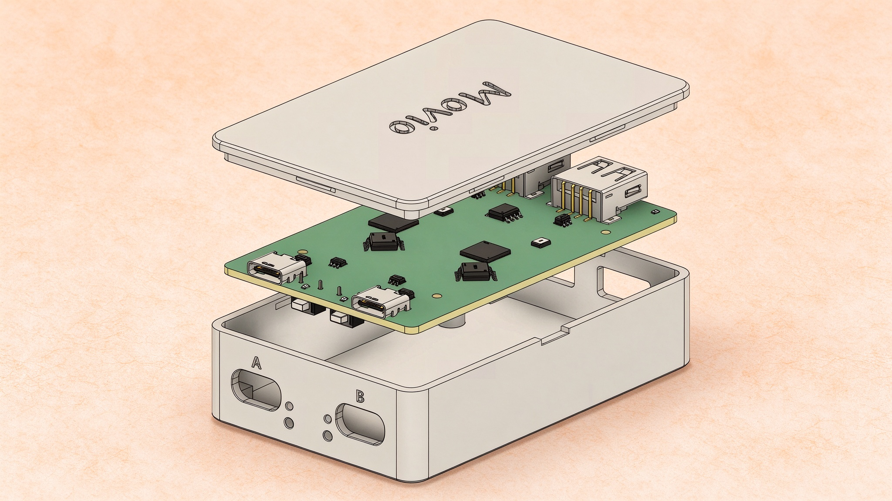
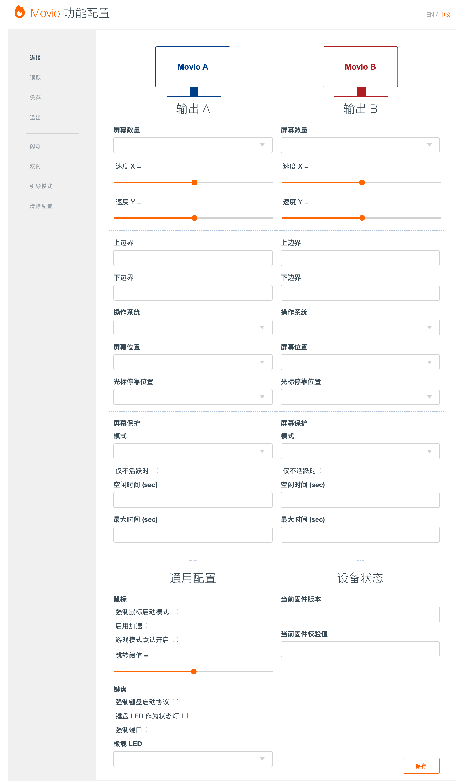

# Movio — 一套键鼠，两台电脑

[English](README.md) · **简体中文**

Movio 是一款开源硬件键鼠切换器，让一套键盘和鼠标同时控制两台电脑。把光标移到两台电脑共享的屏幕边缘并继续移动，光标就会穿到另一台电脑，键盘输入也会自动跟随。两台电脑都把 Movio 识别为标准 USB HID 键鼠设备，因此无需安装任何软件，切换时也不会重新枚举设备。

Movio 基于 [DeskHop](https://github.com/hrvach/deskhop) 开发，重新设计了中英文配置页，修复了固件稳定性问题，优化了鼠标行为，并提供一键构建脚本。它**不是视频 KVM**：显示器、音箱、摄像头和 USB 存储仍直接连接各自的电脑，两台电脑之间没有数据通道。

> **适用固件 v0.80** · 本文是[《Movio 产品说明书》](Movio_产品说明书.docx)（DOCX）的摘要；安装、配置和安全事项以说明书为准。



## 目录

1. [产品概览](#1-产品概览)
2. [核心特性](#2-核心特性)
3. [工作原理](#3-工作原理)
4. [与 DeskHop 的关系](#4-与-deskhop-的关系)
5. [快速上手](#5-快速上手)
6. [快捷键](#6-快捷键)
7. [配置页面](#7-配置页面)
8. [固件更新](#8-固件更新)
9. [从源码构建](#9-从源码构建)
10. [硬件设计与 PCB 文件](#10-硬件设计与-pcb-文件)
11. [安全、隐私与使用安全](#11-安全隐私与使用安全)
12. [使用限制与兼容性](#12-使用限制与兼容性)
13. [故障排查](#13-故障排查)
14. [常见问题](#14-常见问题)
15. [文档与许可证](#15-文档与许可证)

---

## 1. 产品概览

Movio 位于键盘、鼠标与两台电脑之间。它同时与两台电脑保持 USB 连接，并根据当前选择把键鼠输入转发给其中一台。由于电脑始终不会丢失 HID 设备，切换时只需要改变转发目标，因此不需要等待设备重新枚举。

### 基本参数

| 项目 | 说明 |
|------|------|
| 输入 | 1 个 USB-A 键盘口，1 个 USB-A 鼠标口 |
| 输出 | 2 个 USB 设备口（A / B），分别连接两台电脑 |
| 切换方式 | 鼠标穿屏、`左 Ctrl + Caps Lock`、切换锁定 |
| 屏幕数量 | 每路输出 1–3 块，合计最多 6 块 |
| 隔离 | 两路输出之间通过数字隔离器实现 2kV 设计隔离电压 |
| 配置 | 本地 WebHID 配置页，支持中文/英文，不访问网络 |
| 板卡 | 电源隔离版 2 层板，80 mm × 50 mm，两颗板载 RP2040，设计文件见 [`hardware/`](hardware/) |
| 固件 | v0.80，UF2 格式，同一块 PCB 上的两颗 RP2040 |
| 软件 | 两台电脑均无需安装 |

### 能做什么，不能做什么

| 可以做 | 不能做 |
|--------|--------|
| 用一套键鼠控制两台电脑 | 切换显示器、视频信号或音频 |
| 鼠标穿屏、键盘跟随 | 在两台电脑之间拖拽文件、复制粘贴或共享剪贴板 |
| 分别记住两台电脑的键盘 LED 状态 | 共享麦克风、摄像头或 USB 存储 |
| 支持多显示器布局与屏幕高度校准 | 通过 Wi-Fi、蓝牙或网络控制电脑 |
| 提供游戏模式、慢速鼠标和切换锁定 | 给笔记本充电或作为 USB 充电器 |
| 通过本地网页调整参数 | 绕过操作系统登录、安全策略或 EDR |

---

## 2. 核心特性

| 特性 | 说明 |
|------|------|
| **鼠标穿屏** | 把光标移到两台电脑共享的屏幕边缘并继续移动，即可切换电脑，无需按键。 |
| **键盘跟随** | 切换输出时键盘自动跟随；也可以使用 `左 Ctrl + Caps Lock` 独立切换。 |
| **免驱动** | 两端均使用标准 USB HID 协议，即插即用，无需安装软件。 |
| **跨系统** | 支持 Windows、macOS、Linux 与 Android，不同系统可以混合使用。 |
| **多显示器** | 可在配置页为每路输出选择 1–3 块屏幕，两台电脑合计最多 6 块。 |
| **物理隔离** | 两路输出之间通过数字隔离器实现 2kV 设计隔离电压，不提供跨电脑数据通道。 |
| **本地配置** | 设备自带的 `config.htm` 配置页完全在本地运行，支持中文和英文。 |
| **快捷键** | 支持游戏模式、慢速鼠标、切换锁定、系统锁定和屏幕保护等操作。 |
| **开源** | 硬件、固件与文档开放，代码以 GPLv3 发布。 |

---

## 3. 工作原理

### 3.1 架构

Movio 的核心是两颗 RP2040 微控制器，每颗对应一台电脑。两颗芯片通过 UART 和数字隔离器通信，键盘、鼠标则连接在 USB-A 输入口上。信号路径可以概括为：**键鼠 → Movio → 当前活动电脑**。

### 3.2 鼠标

固件把鼠标的相对移动转换成绝对坐标（0–32767），再发送给当前活动的电脑。当光标到达共享边缘并继续朝另一台电脑方向移动时，Movio 保持 Y 坐标不变（或按校准值缩放），把 X 轴翻到另一侧；光标就会在另一台电脑的屏幕上以相近高度出现，同时活动输出发生切换。

### 3.3 键盘

键盘报告只发送给当前活动输出。通过鼠标切换输出时，键盘自动跟随；也可以使用 `左 Ctrl + Caps Lock` 独立切换键鼠。每次切换时，Movio 会释放所有按下的按键，避免在另一台电脑上出现按键“卡住”，并恢复为每台电脑分别记住的键盘 LED 状态（Caps Lock、Num Lock 等）。

### 3.4 隔离

两路输出之间通过数字隔离器隔开，两台电脑之间没有电气通路。Movio 不提供复制粘贴、文件传输、剪贴板共享或任何其他跨电脑数据通道；来自电脑的键盘 LED 报告也只允许严格的单字节输出。

---

## 4. 与 DeskHop 的关系

Movio 保留了 DeskHop 的核心切换逻辑和双 RP2040 架构，并在此基础上增加了：

- **中英文配置界面** —— 完整的双语支持，默认中文，可在页面右上角一键切换。
- **固件稳定性改进** —— 修复边界检查、CRC32 类型截断、NKRO 回退和系统报告长度检查等问题。
- **鼠标行为优化** —— 虚拟桌面切换更平滑，复合键盘不再导致光标跳动，macOS 拖拽不再出现按键卡住。
- **LED 管理** —— 分离期望/实际 LED 状态，并新增 30Hz LED 同步任务。
- **构建与文档** —— 提供一键构建脚本、中文产品说明书和完整的中文使用文档。

详细对比请参阅 [Movio 与 DeskHop 对比](misc/Movio_vs_DeskHop.md)。

---

## 5. 快速上手

本章用一条最短路径，带您从开箱到第一次穿屏，通常 10 分钟内即可完成。

### 5.1 开箱检查

- Movio 已刷入 **v0.80 或更高版本**固件。全新主板如果还没有固件，请先按[方法二](#84-方法二bootsel-手动刷写)完成首次刷写。
- **两根支持数据传输的 USB 线**，接口与主板的 A/B 设备口匹配（本版电源隔离主板为 USB-C，其他版本以实物为准）。仅充电线无法建立 USB 数据连接。
- 一套 **USB 键盘和鼠标** —— 有线设备，或带 USB 接收器的 2.4GHz 无线设备。纯蓝牙键鼠没有 USB 接收器，不能直接使用。
- **两台已开机、且能通过 USB 供电的电脑**。多数台式机和笔记本在关机状态下也会提供 USB 供电，但仍建议两台都开机。
- **Chrome、Chromium 或 Edge** 浏览器。仅在需要修改配置时使用；Firefox 和 Safari 不支持配置页所需的 WebHID。

> **重要**
> A/B 两路分别由对应电脑的 USB 口供电。只连接一台电脑时，另一路没有供电，双机切换无法正常工作。如果只需在一台电脑上使用键鼠，普通 USB 集线器比 Movio 更简单。如果使用 2.4GHz 无线接收器，可以在单路供电情况下使用键鼠，但要确保接收器插入的 USB-A 接口与已通电的 USB 设备口在同一侧。

### 5.2 连接设备

下图以默认布局“**A 在右、B 在左**”为例。实际摆放可以不同，稍后在第 7 章按真实布局设置即可。

1. **连接键盘** —— 把键盘插入带有键盘图标的 USB-A 输入口。使用无线键盘时，把它的 USB 接收器插入该口。
2. **连接鼠标** —— 把鼠标插入带有鼠标图标的 USB-A 输入口。使用无线鼠标时，把它的接收器插入该口；键鼠合一的接收器插入任一输入口通常都可以。
3. **连接电脑 A** —— 用一根 USB 数据线，把 A 端连接到电脑 A。
4. **连接电脑 B** —— 用另一根 USB 数据线，把 B 端连接到电脑 B。

| 接口 / 部件 | 作用 |
|-------------|------|
| 键盘 USB-A 口 | 连接 USB 键盘，或带 USB 接收器的 2.4GHz 无线键盘 |
| 鼠标 USB-A 口 | 连接 USB 鼠标，或带 USB 接收器的 2.4GHz 无线鼠标 |
| A 设备口 | 连接电脑 A |
| B 设备口 | 连接电脑 B |
| BOOTSEL 按键 ×2 | 按住后插入该侧 USB 口，进入 RPI-RP2 引导模式，用于设备急救恢复 |
| 板载状态 LED ×2 | 指示当前输出、配置模式或固件写入状态 |
| 板载电源 LED ×2 | 指示该侧电源连接状态 |

两个 USB-A 口都能自动识别键盘和鼠标，因此把键鼠插反通常也能工作；但为了获得最好的兼容性，建议按图标连接。如果开启“强制端口”，则键盘必须接 A 侧、鼠标必须接 B 侧。

> **警告**
> 不要把电脑插入 USB-A 输入口，也不要把键盘、鼠标插入 A/B 输出端。接口方向错误时，电脑可能无法识别 Movio，键鼠也不会有反应。配置模式只会在键盘所连接的那一侧启动，请到连接键盘的电脑上查找 MOVIO 盘。

### 5.3 上电与识别

两台电脑都连接好后，Movio 会立即上电。等待约 5–10 秒，让两台电脑完成 USB 枚举。电脑会把 Movio 识别为标准 USB HID 键鼠设备，通常不需要安装驱动，也不会出现额外的磁盘或网络设备。

插入键盘或鼠标时，板载 LED 和键盘 LED 通常会快速闪烁 2–3 次，表示设备已被识别。正常使用时，当前活动输出对应的板载 LED 会保持点亮（默认“显示活动输出”模式）。

| LED 行为 | 含义 | 建议动作 |
|----------|------|----------|
| 插入键鼠后快速闪烁 2–3 次 | 设备已被识别 | 正常，继续下一步 |
| 当前输出对应的板载 LED 常亮 | 正常待机，表示活动输出 | 无需处理 |
| 板载 LED 周期性闪烁 | 设备处于配置模式 | 打开 MOVIO 盘进行配置，或等待自动退出 |
| 板载 LED 持续快速闪烁 | 正在写入或同步固件 | 保持供电和 USB 连接，不要拔线 |
| 所有 LED 都不亮 | 未供电、LED 被禁用或设备未启动 | 检查两台电脑供电、线缆和 LED 模式 |

如果外壳遮挡了板载 LED，可以开启“键盘 LED 作为状态灯”，或使用配置页的“闪烁 / 双闪”按钮辅助判断。

### 5.4 第一次穿屏

设备首次上电时，默认活动输出为 **A**，默认布局为 **A 在右、B 在左**。把光标移到 A 屏幕的左边缘并继续向左移动，光标就会穿到 B；反向操作则从 B 回到 A。

键盘会自动跟随：光标出现在哪台电脑上，键盘输入就发送到哪台电脑。您也可以随时按 `左 Ctrl + Caps Lock` 独立切换键鼠输出。

| 实际布局 | 从 A 到 B | 从 B 到 A |
|----------|-----------|-----------|
| A 在右、B 在左（默认） | 把光标向左移过共享边缘 | 把光标向右移过共享边缘 |
| A 在左、B 在右 | 把光标向右移过共享边缘 | 把光标向左移过共享边缘 |

如果光标到达边缘后没有切换，请依次检查：**屏幕位置**是否与实际布局一致；**跳转阈值**是否设置过大；是否开启了游戏模式或切换锁定；是否正按住鼠标按键；光标是否位于主屏（第 1 块屏幕）。

> **提示**
> 第一次切换时，建议先把光标放在 A 屏幕的垂直中间位置，再缓慢推过边缘，这样最容易观察 Y 坐标是否保持。切到 B 后，在 B 上输入几个字符，确认键盘确实跟随；再移回 A，确认键盘也切回。

### 5.5 完成最小必要配置

出厂默认只是常见示例：输出 A 默认为 macOS、位于右侧；输出 B 默认为 Linux、位于左侧。如果您的实际系统或摆放方向不同，必须进入配置页修改，否则可能出现切换方向相反、“锁定两台电脑”发送错误快捷键等问题。

1. **进入配置模式** —— 确认键盘已连接且设备处于正常模式，按住 `左 Ctrl` 和 `右 Shift`，依次按下 `C` 和 `O`。设备会重启，键盘所连接的那台电脑上会出现名为 **MOVIO** 的 USB 盘。
2. **打开配置页** —— 在 MOVIO 盘中双击 `config.htm`，使用 Chrome、Chromium 或 Edge 打开。不要使用 Firefox 或 Safari。
3. **连接设备** —— 点击页面左侧的“连接”，在浏览器弹窗中选择 Movio 设备并允许访问。连接成功后页面会自动读取当前配置；如果没有自动读取，点击“读取”。
4. **设置两台电脑** —— 在“输出 A”和“输出 B”两栏中，分别按实际环境设置操作系统、屏幕位置和屏幕数量。第一次配置时，其余选项建议保持默认。
5. **保存并退出** —— 点击“保存”，等待按钮显示“完成”；再点击“退出”。设备重启后 MOVIO 盘消失，回到正常模式。

| 配置项 | 输出 A 示例 | 输出 B 示例 | 说明 |
|--------|-------------|-------------|------|
| 操作系统 | Windows | Linux | 必须按实际系统设置；影响系统锁定快捷键和多屏兼容逻辑。 |
| 屏幕位置 | 右 | 左 | 该电脑在整体布局中的左/右位置，不是主屏在电脑内部的位置。 |
| 屏幕数量 | 1 | 1 | 单屏填 1；多屏按实际数量填写，主屏应紧邻另一台电脑。 |
| 其余选项 | 保持默认 | 保持默认 | 速度、边界、屏幕保护等可等基本切换正常后再调整。 |

配置页中的修改会立即下发到设备，但只有点击“保存”才会写入 Flash。配置模式约 5 分钟无操作会自动退出，未保存的修改会丢失。

### 5.6 校准屏幕高度

如果两台电脑的显示器尺寸、分辨率或垂直位置不同，切换后光标高度可能不一致。此时需要校准屏幕高度，让光标在新屏幕上出现在相近的位置。两台显示器完全相同且并排对齐时，可以跳过本节。

1. **切到较大屏幕** —— 先切换到显示器较大的那台电脑，把光标移到该屏幕上。
2. **对准顶边** —— 把光标停在与较小屏幕顶边对应的高度，保持不动。
3. **记录上边界** —— 按 `右 Shift + F12 + Y`。板载 LED 和键盘 LED 会闪烁确认，当前高度被记录为上边界。
4. **记录下边界** —— 把光标移到与较小屏幕底边对应的高度，再按一次 `右 Shift + F12 + Y`。
5. **验证** —— 在两台电脑之间来回切换几次，确认光标高度基本一致；如有偏差，可重复校准或在配置页手动微调。


校准值会保存到两颗 RP2040 的 Flash，并同步生效。光标位于屏幕上半部分时，快捷键记录“上边界”；位于下半部分时记录“下边界”。如果误校准，可以在配置页把上/下边界改回 0 和 32767，或使用“清除配置”恢复默认。更换显示器或调整显示器位置后，需要重新校准。

---

## 6. 快捷键

所有快捷键都由 Movio 自身处理，不需要安装驱动。按键名称均指键盘上的物理按键：左 Ctrl 与右 Ctrl、左 Shift 与右 Shift 是不同的按键，不能互相替代。组合键中的“+”表示同时按住；像 `左 Ctrl + 右 Shift + C + O` 这样的多键组合，应先按住修饰键，再依次按下字母键。

部分薄膜键盘存在按键冲突（Ghosting），无法同时上报多个按键，可能导致组合键不触发；此时可放慢按键顺序，或换用支持 6KRO/NKRO 的键盘。除“慢速鼠标”外，下列快捷键都会被 Movio 拦截，**不会**发送到电脑；如果某个应用使用了相同组合键，该应用将收不到这个快捷键。

### 6.1 配置类快捷键

| 操作 | 快捷键 | 说明 |
|------|--------|------|
| 进入 / 退出配置模式 | `左 Ctrl` + `右 Shift` + `C` + `O` | 设备重启，键盘侧出现 MOVIO 盘；在配置模式中再次按下可退出。 |
| 重置配置 | `右 Shift` + `F12` + `D` | 立即清除两颗 RP2040 的配置并恢复默认值，无二次确认。 |
| 保存屏幕高度偏移 | `右 Shift` + `F12` + `Y` | 把当前光标高度记录为上边界或下边界，并保存到 Flash。 |

### 6.2 使用类快捷键

| 操作 | 快捷键 | 说明 |
|------|--------|------|
| 切换输出 | `左 Ctrl` + `Caps Lock` | 键鼠一起切换到另一台电脑；受切换锁定影响。 |
| 游戏模式 | `左 Ctrl` + `右 Shift` + `G` | 鼠标改为相对模式，移动到边缘不再穿屏；键盘快捷键仍可切换（除非同时开启了切换锁定）。 |
| 屏幕保护：弹球 | `左 Ctrl` + `右 Shift` + `S` | 在当前输出启用 Pong 模式；临时生效，不写入 Flash。 |
| 屏幕保护：抖动 | `左 Ctrl` + `右 Shift` + `J` | 在当前输出启用 Jitter 模式；临时生效，不写入 Flash。 |
| 关闭屏幕保护 | `左 Ctrl` + `右 Shift` + `X` | 关闭当前输出的屏幕保护；临时生效。 |
| 慢速鼠标 | `右 Ctrl` + `右 Alt` | 鼠标速度约降至原来的 1/4，便于精确定位；再次按下恢复。 |
| 切换锁定 | `右 Ctrl` + `K` | 禁止鼠标穿屏和快捷键切换；再次按下解锁；重启后失效。 |
| 锁定两台电脑 | `右 Ctrl` + `L` | 向两台电脑发送系统锁定快捷键；需先在配置页设置操作系统。 |

> 快捷键目前不能在配置页中修改。如需更改，请在 [`src/include/user_config.h`](src/include/user_config.h) 中重新定义 `HOTKEY_MODIFIER`、`HOTKEY_TOGGLE` 等宏，然后重新编译固件。

### 6.3 两种“锁定”的区别

| 功能 | 快捷键 | 作用 | 是否持久 |
|------|--------|------|----------|
| 切换锁定 | `右 Ctrl` + `K` | 禁止鼠标穿屏和快捷键切换，防止误切换。 | 否，重启后失效 |
| 锁定两台电脑 | `右 Ctrl` + `L` | 向两台电脑发送系统锁定快捷键，锁定操作系统会话。 | 否，仅执行一次 |

“锁定两台电脑”依赖正确的操作系统配置：Windows 发送 `Win + L`，Linux 发送 `Super + L`，macOS 发送 `Ctrl + Cmd + Q`。系统选择错误可能发送无效的快捷键；部分 Linux 桌面环境的锁定快捷键不同，也可能无效。该功能只锁定电脑系统，不会阻止您之后切换输出。

### 6.4 操作反馈与按键冲突

- **反馈** —— 大多数快捷键执行后，板载 LED 和键盘 LED 会快速闪烁约 0.4 秒（2–3 次）。进入配置模式后，LED 会周期性闪烁，直到退出。
- **固件写入** —— 升级期间以板载 LED 持续闪烁为主，键盘 LED 不保证同步闪烁。
- **按键冲突** —— 部分键盘无法同时上报多个按键，导致组合键不触发。优先使用支持 6KRO/NKRO 的键盘，或放慢按键顺序。
- **应用冲突** —— 快捷键会被 Movio 拦截，不会发送到电脑；如果某个应用使用了相同组合键，该应用收不到这个快捷键。
- **Caps Lock** —— 单独按下仍然正常工作；只有与左 Ctrl 同时按下时，才会被识别为切换快捷键。
- **慢速鼠标的例外** —— 与其他快捷键不同，慢速鼠标组合会把 Ctrl 和 Alt 修饰键传递给操作系统，因此某些应用可能同时收到 `Ctrl+Alt`。如果遇到冲突，可以改用降低“速度 X / 速度 Y”的方式。

---

## 7. 配置页面

Movio 的配置页是一个完全本地的 WebHID 页面。它不需要联网，也不会加载外部脚本；所有参数都直接读写设备。

### 7.1 进入配置模式

1. **进入配置模式** —— 确认键盘已连接且设备处于正常模式，按 `左 Ctrl + 右 Shift + C + O`。设备重启后，在键盘所在电脑上会出现 **MOVIO** 盘。
2. **打开页面** —— 双击 MOVIO 盘中的 `config.htm`。配置页是自解压的本地 HTML 文件，用浏览器打开时会自动展开；不要用文本编辑器查看。
3. **连接设备** —— 点击左侧“连接”，在浏览器弹窗中选择 Movio 设备并允许访问。连接成功后页面会自动读取配置；如果没有自动读取，点击“读取”。
4. **修改并保存** —— 按实际环境调整参数。修改会立即下发，但只有点击“保存”才会写入 Flash。完成后点击“退出”，设备重启回到正常模式。

配置页完全在本地运行，不加载外部 JavaScript，也不会上传配置数据。WebHID 连接需要用户明确授权；正常模式下不会暴露厂商自定义 HID 接口，只有配置模式才启用。配置模式约 5 分钟无操作会自动退出。

### 7.2 页面布局与操作按钮

配置页分为五个区域：顶部品牌与语言切换、左侧操作菜单、输出 A / 输出 B 两栏、下方通用配置、右下方设备状态与保存按钮。输出 B 的字段与输出 A 完全对称。页面右上角提供 **EN / 中文** 切换，语言选择会保存在浏览器本地存储中，默认中文；按钮点击后通常显示“✓ 已执行”，保存成功后保存按钮会短暂显示绿色“完成”。



| 按钮 | 功能 | 使用说明 |
|------|------|----------|
| 连接 | 通过 WebHID 连接 Movio 设备 | 首次使用或页面刷新后需要重新连接。 |
| 读取 | 从设备读取当前所有配置值 | 保存后可再点一次，确认值已更新。 |
| 保存 | 把当前配置写入两颗 RP2040 的 Flash | 修改不会自动持久化，必须点击保存。 |
| 退出 | 重启设备，退出配置模式 | MOVIO 盘会消失，设备回到正常模式。 |
| 闪烁 | 让当前配置侧 RP2040 的板载 LED 闪烁 | 用于识别设备，不影响配置。 |
| 双闪 | 让两颗 RP2040 的板载 LED 同时闪烁 | 用于确认两颗 RP2040 都正常工作。 |
| 引导模式 | 让两颗 RP2040 进入 BOOTSEL 引导模式 | 会出现 RPI-RP2 盘；键鼠暂时不可用，慎用。 |
| 清除配置 | 擦除两颗 RP2040 的配置并恢复默认值 | 无二次确认，会丢失所有设置，慎用。 |

> **注意**
> “引导模式”和“清除配置”会立即改变设备状态。除非您明确知道自己在做什么，否则不要随意点击。

### 7.3 输出 A / 输出 B 设置

输出 A 与输出 B 的字段完全对称，分别对应两台电脑。以下默认值来自当前固件；如果设备中已有配置，页面“读取”到的值优先于默认值。

| 配置项 | 范围 / 默认值 | 说明 |
|--------|---------------|------|
| 屏幕数量 | 1 / 2 / 3 · 默认 1 | 该电脑连接的屏幕数量。主屏应紧邻另一台电脑，扩展屏向外侧延伸。Linux 通常建议设为 1。 |
| 速度 X | 1–100 · 默认 16 | 鼠标水平方向速度；数值越大移动越快。建议先保持默认，确认切换正常后再微调。 |
| 速度 Y | 1–100 · 默认 28 | 鼠标垂直方向速度；数值越大移动越快。 |
| 上边界 | 0–32767 · 默认 0 | 屏幕高度校准的上边界；0 表示屏幕顶部。建议用 `右 Shift + F12 + Y` 校准。 |
| 下边界 | 0–32767 · 默认 32767 | 屏幕高度校准的下边界；32767 表示屏幕底部。 |
| 操作系统 | Linux / MacOS / Windows / Android / 其他 · A 默认 MacOS，B 默认 Linux | 影响系统锁定快捷键和多屏兼容逻辑，必须按实际系统设置。 |
| 屏幕位置 | 左 / 右 · A 默认右，B 默认左 | 该电脑在整体布局中的左/右位置，不是主屏在电脑内部的位置。 |
| 光标停靠位置 | 上 / 下 / 上次位置 · 默认上 | 跨电脑切换时，旧光标的停靠高度；一般保持“上”即可。 |
| 屏幕保护模式 | 禁用 / 弹球 / 抖动 · 默认禁用 | 向电脑发送微小鼠标移动，防止休眠或锁屏。 |
| 仅不活跃时 | 勾选 / 不勾选 · 默认不勾选 | 只在该输出不是当前活动输出时运行屏幕保护。 |
| 空闲时间（秒） | 秒 · 默认 240 | 该输出无输入多久后启动屏幕保护。 |
| 最大时间（秒） | 秒 · 默认 0（不限） | 屏幕保护最长运行时间；0 表示不限制。 |

默认的操作系统和屏幕位置只是常见示例，不代表您的实际环境。首次使用必须按实际电脑修改；否则可能出现切换方向相反、多屏异常或系统锁定快捷键错误。

**关于屏幕位置**：“屏幕位置”描述的是该电脑在整体桌面布局中的位置，而不是主屏在该电脑内部的位置。默认布局为 A 在右、B 在左；如果您的实际摆放相反，请把两边的“屏幕位置”对调。Movio 只支持左右并排布局，不支持上下堆叠。

**关于多屏**：每台电脑的主屏应紧邻另一台电脑，扩展屏向主屏的外侧延伸。

```text
B3（扩展）— B2（扩展）— B1（主屏）  │  A1（主屏）— A2（扩展）— A3（扩展）
```

不要把扩展屏放在主屏和另一台电脑之间，否则切换逻辑会与视觉布局不一致。Windows 和 macOS 的多屏方案使用兼容模式，光标手感可能与单屏略有不同；Linux 通常由桌面环境管理多显示器，建议把屏幕数量设为 1。

**关于边界值**：0 表示屏幕顶部，32767 表示底部。两台显示器尺寸相同时，保持 0 / 32767 即可；尺寸或垂直位置不同时，使用 `右 Shift + F12 + Y` 校准比手动填写更可靠。手动修改边界值后需要点击“保存”。

### 7.4 屏幕保护

Movio 的“屏幕保护”不是显示器屏保，而是向电脑发送微小的鼠标移动，防止电脑进入休眠、锁屏或启动屏保。它不会产生鼠标点击，也不会发送按键。对于使用 USB 扩展坞、休眠后难以唤醒的电脑，这个功能尤其有用。

| 模式 | 行为 | 适用场景 |
|------|------|----------|
| 禁用 | 不发送任何自动移动。 | 默认；不需要防止锁屏时使用。 |
| 弹球（Pong） | 光标像弹球一样在屏幕上移动，约每 5ms 更新一次。 | 需要持续保持电脑活跃，且不在意光标移动。 |
| 抖动（Jitter） | 每隔约 10 秒做一次极轻微移动（约 2 个坐标单位）。 | 希望尽量不干扰正常使用，只防止休眠。 |

勾选“仅不活跃时”后，只有当该输出不是当前活动输出时才运行屏幕保护。例如您正在使用 A，希望 B 不要锁屏，可以给 B 开启屏幕保护并勾选“仅不活跃时”。“空闲时间”表示该输出无输入多久后启动，默认 240 秒；“最大时间”表示屏幕保护最长运行时间，0 表示不限制。

屏幕保护可以通过快捷键临时启用或关闭，但快捷键不会写入 Flash。需要持久化时，请在配置页设置并保存。屏幕保护会增加电脑功耗，也可能干扰某些全屏应用，请按需使用。

### 7.5 通用配置

通用配置对本设备全局生效，不区分输出 A/B。首次使用时建议保持默认，确认基本切换正常后再逐项调整。

| 配置项 | 默认值 | 说明 |
|--------|--------|------|
| 强制鼠标启动模式 | 关闭 | 用简单的 Boot 协议初始化鼠标，解决部分鼠标兼容问题；可能损失部分高级功能，仅在需要时开启。 |
| 启用加速 | 开启 | 根据鼠标移动速度自动加速；需要线性手感或精确瞄准时可关闭。 |
| 游戏模式默认开启 | 关闭 | 设备启动直接进入游戏模式（相对鼠标、鼠标不穿屏）；适合游戏/虚拟机用户。 |
| 跳转阈值 | 0 | 跨电脑切换需要额外移动的距离，范围 0–3000；越大越难误触，0 表示到达边缘即可切换。 |
| 强制键盘启动协议 | 关闭 | 用 Boot 协议初始化键盘，提升 BIOS/UEFI、BitLocker 等场景的兼容性；可能影响部分高级键功能。 |
| 键盘 LED 作为状态灯 | 关闭 | 用 Caps Lock 灯指示当前输出：亮 = 输出 B，灭 = 输出 A；会覆盖 Caps Lock 原本的指示灯含义。 |
| 强制端口 | 关闭 | 强制键盘接 A 侧、鼠标接 B 侧；只有您的接线方式符合时才开启。 |
| 板载 LED | 显示活动输出 | 可选：显示活动输出 / 短空闲 / 长空闲 / 仅状态闪烁 / 禁用。 |

**启用加速**默认开启。设备会根据鼠标移动速度自动放大位移，慢速移动更精细，快速移动更快。如果觉得光标“飘”或瞄准不稳定，可以关闭加速，获得更线性的手感；关闭后速度只由“速度 X/Y”决定。

**跳转阈值**只影响跨电脑切换，不影响同一台电脑内主屏/扩展屏之间的本地切换。0 表示光标到达边缘即可切换；如果经常误切换，可设置为 200–500；如果切换困难，设为 0。该值是两个输出共用的通用配置。

**强制鼠标启动模式**、**强制键盘启动协议**和**强制端口**用于解决兼容性问题。修改后需要重启设备或重新插拔键鼠才会生效。开启这些选项可能损失部分高级功能；如果设备工作正常，建议保持关闭。

| 板载 LED 模式 | 行为 |
|---------------|------|
| 显示活动输出（默认） | 当前活动输出对应的板载 LED 常亮，另一颗对应的 LED 灭。 |
| 短空闲（1 秒） | 当前输出为活动输出且有输入时亮，停止输入约 1 秒后灭。 |
| 长空闲（2 分钟） | 当前输出为活动输出且有输入时亮，停止输入约 2 分钟后灭。 |
| 仅状态闪烁 | 平时灭，只在检测到 USB 设备、快捷键确认、配置模式等状态事件时闪烁。 |
| 禁用 | 板载 LED 不用于状态指示。 |

如果外壳遮挡了板载 LED，可以开启“键盘 LED 作为状态灯”，通过 Caps Lock 灯判断当前输出；也可以使用配置页的“闪烁 / 双闪”按钮定位设备。开启后，Caps Lock 灯不再表示大写锁定，而是表示当前输出：亮 = 输出 B 正在使用，灭 = 输出 A 正在使用。Num Lock、Scroll Lock 灯仍按系统状态显示。

### 7.6 保存、生效与退出

配置页中的输入框、下拉框和滑块在值改变时会立即下发到设备，但只有点击“保存”后才会写入 Flash。未保存的修改在退出配置模式、设备重启或断电后丢失。

| 修改内容 | 生效时机 | 是否需要保存 |
|----------|----------|--------------|
| 速度 X/Y、边界值、跳转阈值 | 立即生效 | 需要保存，否则重启后恢复 |
| 屏幕保护模式、空闲/最大时间 | 立即生效 | 需要保存 |
| 板载 LED 模式、键盘 LED 状态灯 | 立即生效 | 需要保存 |
| 强制鼠标启动模式 | 重启或重新插拔鼠标后生效 | 需要保存 |
| 强制键盘启动协议 | 重启或重新插拔键盘后生效 | 需要保存 |
| 强制端口 | 重启或重新插拔键鼠后生效 | 需要保存 |
| 游戏模式默认开启 | 设备重启后生效 | 需要保存 |
| 操作系统、屏幕位置、屏幕数量 | 立即影响切换逻辑 | 需要保存 |

- **保存** —— 把当前配置写入两颗 RP2040 的 Flash。左侧菜单的“保存”和右下角的“保存”按钮效果相同。
- **退出** —— 让配置侧 RP2040 重启回正常模式，MOVIO 盘消失。
- **自动退出** —— 约 5 分钟无配置操作后自动重启，未保存的修改会丢失。
- **再次按配置快捷键** —— 在配置模式中再次按 `左 Ctrl + 右 Shift + C + O`，也会退出配置模式。
- **读回确认** —— 保存后建议再点击一次“读取”，确认设备中的值确实已经更新。

> **提示**
> Movio 当前不提供配置导出/导入功能。首次配置完成后，建议截图保存配置页；升级固件前记录操作系统、屏幕位置、屏幕数量和边界值，便于升级后快速恢复。

### 7.7 Linux udev 权限

在 Linux 上，Chrome/Chromium 访问 HID 设备可能需要 udev 规则。配置模式下的设备 ID 是 **2e8a:107c**，而不是正常模式的 **1209:c000**；如果只添加正常模式规则，配置页可能看不到设备。

创建 `/etc/udev/rules.d/99-movio.rules`，写入以下内容：

```udev
# Movio 正常模式（可选）
KERNEL=="hidraw*", ATTRS{idVendor}=="1209", ATTRS{idProduct}=="c000", TAG+="uaccess"

# Movio 配置模式（WebHID 需要）
KERNEL=="hidraw*", ATTRS{idVendor}=="2e8a", ATTRS{idProduct}=="107c", TAG+="uaccess"
```

然后重新加载规则并重新插拔设备：

```shell
sudo udevadm control --reload-rules
sudo udevadm trigger
```

如果您的系统不支持 `uaccess`，可以改用 `plugdev` 组：

```udev
KERNEL=="hidraw*", ATTRS{idVendor}=="2e8a", ATTRS{idProduct}=="107c", GROUP="plugdev", MODE="0660"
```

```shell
sudo usermod -aG plugdev "$USER"
```

修改组后需要注销并重新登录。重新插拔设备后，可以用以下命令确认设备 ID：

```shell
lsusb | grep -E "2e8a:107c|1209:c000"
```

| 模式 | VID:PID | 说明 |
|------|---------|------|
| 正常模式 | `1209:c000` | 标准 HID 键鼠设备。 |
| 配置模式 | `2e8a:107c` | 包含 MOVIO 虚拟盘和厂商 HID 接口。 |

如果使用 Flatpak、Snap 等沙箱版浏览器，可能还需要授予 USB/HID 设备访问权限；必要时改用系统包管理器安装的 Chrome/Chromium。

### 7.8 浏览器兼容性

| 浏览器 | 支持 WebHID | 说明 |
|--------|-------------|------|
| Chrome | 是 | 推荐。 |
| Chromium | 是 | 推荐。 |
| Edge | 是 | 基于 Chromium，通常可用。 |
| Firefox | 否 | 不支持 WebHID，无法连接设备。 |
| Safari | 否 | 不支持 WebHID。 |
| 移动端浏览器 | 通常不支持 | 请在电脑上配置。 |

`config.htm` 是自解压页面，用文本编辑器查看时可能像压缩代码，这是正常现象；请始终用浏览器打开。

---

## 8. 固件更新

Movio 使用 UF2 格式固件。两颗 RP2040 刷写**同一个** `movio.uf2` 文件，芯片角色（A/B）由硬件自动探测，不需要分别编译 A/B 两个版本。

### 8.1 版本与文件规则

| 项目 | 说明 |
|------|------|
| 固件文件 | `movio.uf2`；两颗 RP2040 使用同一个文件 |
| 当前版本 | v0.80 |
| 适用硬件 | 同一块 PCB 上的两颗 RP2040；电源隔离版为 USB-A 输入、USB-C 输出 |
| 完整性 | 使用 CRC32 校验检测传输/写入错误，不是密码学签名 |
| 配置兼容 | 配置结构版本变化时，设备会自动恢复默认配置；升级后请检查操作系统、屏幕位置和屏幕数量 |
| 升级方式 | MOVIO 虚拟盘（推荐）、BOOTSEL / RPI-RP2、配置页“引导模式” |

请从 [dl.acenova.tech](https://dl.acenova.tech) 或项目 [Releases](https://github.com/likeaturtle/Movio/releases) 下载固件。只向 MOVIO 盘复制 `.uf2` 文件；`.elf`、`.bin` 等其他文件不会生效。不要使用来路不明的固件。

### 8.2 更新前准备

- 保持**两台电脑开机**，A/B 两端都连接且供电稳定。升级时最稳妥的状态是两台电脑都在运行；另一颗 RP2040 需要通过板间通信完成同步，也需要自己的供电。
- 使用**可靠的数据线**，优先直连电脑，不要使用不稳定的 USB 集线器、延长线或劣质电源。
- **下载并确认固件版本**。从 dl.acenova.tech 下载最新的 `movio.uf2`；如果发布页提供校验值，建议先核对文件完整性。
- **记录当前配置**。截图保存配置页，记录两台电脑的操作系统、屏幕位置、屏幕数量和边界值。
- **阅读发布说明**。确认新版本没有已知的兼容性问题，并保留一份已知可用的旧固件，以便需要时恢复。

> **警告**
> 升级过程中不要断电，不要拔出 USB 线、关闭电脑、格式化 MOVIO 盘或强制重启设备。写入中断可能导致固件损坏，需要按[方法二](#84-方法二bootsel-手动刷写)使用 BOOTSEL 恢复。升级期间板载 LED 会持续闪烁；闪烁停止且设备重新枚举后，才表示升级完成。

### 8.3 方法一：MOVIO 配置盘升级（推荐）

这是日常升级最方便的方法，适用于已经能正常运行 Movio 固件的设备。整个过程只需要把 UF2 文件复制到 MOVIO 盘，另一颗 RP2040 会自动同步。

1. **进入配置模式** —— 保持两台电脑开机和 USB 连接。按 `左 Ctrl + 右 Shift + C + O`，设备重启后，键盘所在电脑上出现 MOVIO 盘。
2. **确认盘符** —— 打开 MOVIO 盘，确认根目录中能看到 `config.htm`。如果盘没有出现，先按 [5.5 节](#55-完成最小必要配置)检查配置模式和键盘侧。
3. **复制固件** —— 把新的 `movio.uf2` 复制到 MOVIO 盘根目录。复制过程中板载 LED 会闪烁，这是正常现象。
4. **等待写入** —— 当前 RP2040 先写入固件并重启；随后通过两颗 RP2040 之间的通信把固件同步到另一颗。两颗 RP2040 的 LED 都可能闪烁。
5. **等待重启** —— 两颗 RP2040 都停止闪烁、设备重新枚举后，升级完成。期间不要拔线、不要关闭电脑。
6. **验证版本** —— 重新进入配置模式并连接配置页，在“设备状态”中确认两颗 RP2040 的固件版本一致，且符合预期。

只需要向一颗 RP2040 复制固件。另一颗在检测到对方版本更新后，会通过 UART 自动拉取固件并写入；因此两台电脑都连接、都供电时升级最稳妥。如果只连接了一台电脑，另一路没有供电，自动同步无法完成。

MOVIO 盘不是普通 U 盘，而是固件提供的虚拟盘，只用于接收 UF2 数据块和提供 `config.htm`。不要把它当作存储盘使用，也不要格式化。

### 8.4 方法二：BOOTSEL 手动刷写

全新主板、升级失败、设备无法正常启动，或需要降级时，可以使用 RP2040 的 ROM Bootloader 手动刷写。该方法需要分别对两颗 RP2040 操作。

1. **断开连接** —— 断开键盘、鼠标和两台电脑的 USB 线，只保留要刷写的那颗 RP2040 对应的 USB 设备口与一台电脑的连接。如果外壳遮挡 BOOTSEL 按钮，先打开外壳。
2. **按住 BOOTSEL** —— 按住该 RP2040 对应的 BOOTSEL 按键不放。
3. **插入 USB** —— 把该 RP2040 对应的 USB 设备口连接到电脑，保持按住 BOOTSEL，直到电脑出现名为 **RPI-RP2** 的 U 盘。
4. **松开按钮** —— 看到 RPI-RP2 盘后松开 BOOTSEL。
5. **复制固件** —— 把 `movio.uf2` 复制到 RPI-RP2 盘根目录。
6. **等待重启** —— 等待设备自动重启，RPI-RP2 盘消失。
7. **刷写另一颗** —— 对另一颗 RP2040 重复步骤 2–6。两颗使用同一个 UF2 文件，不需要区分 A/B。
8. **重新连接** —— 两颗 RP2040 都刷写完成后，重新连接键盘、鼠标和两台电脑，按[第 5 章](#5-快速上手)完成配置检查。

RP2040 的 ROM Bootloader 无法被固件擦除，因此只要硬件没有损坏，通常都可以通过 BOOTSEL 恢复。恢复后配置可能被重置，需要重新设置操作系统、屏幕位置和屏幕数量。

| 场景 | 推荐方式 | 说明 |
|------|----------|------|
| 全新主板 | BOOTSEL | 空白 RP2040 没有 Movio 固件，MOVIO 盘不会出现。 |
| 日常版本升级 | MOVIO 盘 | 最方便，另一颗 RP2040 自动同步。 |
| 升级失败 / 无法启动 | BOOTSEL | 分别刷写两颗 RP2040，确保版本一致。 |
| 需要降级 | BOOTSEL | 自动同步只升级、不降级；降级必须手动刷写两颗 RP2040。 |
| 配置页可用但盘异常 | 配置页“引导模式” | 让两颗 RP2040 进入 BOOTSEL，再分别复制 UF2。 |

### 8.5 方法三：配置页“引导模式”

如果设备还能进入配置模式，但 MOVIO 盘升级不稳定，可以在配置页点击“引导模式”，让两颗 RP2040 进入 BOOTSEL，再手动复制固件。

1. **进入配置模式** —— 按 `左 Ctrl + 右 Shift + C + O`，打开 MOVIO 盘中的 `config.htm` 并连接设备。
2. **点击引导模式** —— 点击左侧“引导模式”。两颗 RP2040 会重启进入 BOOTSEL，键鼠暂时不可用。
3. **找到 RPI-RP2** —— 电脑上可能出现一个或两个 RPI-RP2 盘；如果只出现一个，先刷写它，再处理另一颗。
4. **复制固件** —— 把 `movio.uf2` 分别复制到每个 RPI-RP2 盘。
5. **重新连接** —— 等待板子重启，重新连接键鼠和两台电脑，按 [8.7 节](#87-升级后验证)验证版本。

> **注意**
> 引导模式会让键鼠暂时不可用。进入引导模式后，Movio 不再作为键鼠切换器工作，直到两颗 RP2040 都刷写完成并重启。请提前保存工作，避免在会议、演示或远程操作中执行。

### 8.6 双 RP2040 同步与版本规则

两颗 RP2040 通过 UART 心跳交换运行版本。若一颗发现另一颗的版本更新，它会自动从对方拉取固件并写入；若对方版本相同或更旧，则不会触发同步。因此自动同步**只会升级，不会降级**。

- **同一文件** —— 两颗 RP2040 都刷写同一个 `movio.uf2`，芯片角色（A/B）由硬件自动探测，不需要分别编译。
- **只升级** —— 自动同步的触发条件是“对方版本更新”。如果要降级，必须用 BOOTSEL 分别刷写两颗 RP2040。
- **配置兼容** —— 配置结构版本变化时设备会自动恢复默认配置；升级后请检查操作系统、屏幕位置和屏幕数量。
- **完整性** —— 写入完成后会校验 CRC32；校验失败时设备可能进入引导模式，需要用 BOOTSEL 恢复。
- **高安全场景** —— 固件支持在编译时通过 `DISABLE_FW_UPGRADE` 关闭跨芯片升级，普通用户不建议修改。

如果升级后只有一颗 RP2040 更新，先保持两台电脑连接并等待一段时间，让心跳触发同步；如果仍未完成，使用 BOOTSEL 分别刷写两颗 RP2040 到同一版本。不要长期只刷一颗 RP2040，版本不一致可能导致行为异常。

### 8.7 升级后验证

1. **检查版本** —— 进入配置模式并连接配置页，在“设备状态”中查看“当前固件版本”和“当前固件校验值”。两颗 RP2040 应显示相同版本。
2. **检查配置** —— 核对操作系统、屏幕位置、屏幕数量和边界值是否仍符合实际环境；如果配置被重置，重新设置并保存。
3. **测试切换** —— 测试鼠标从 A 穿到 B、再从 B 穿回 A，确认键盘跟随。
4. **测试快捷键** —— 测试 `左 Ctrl + Caps Lock`、游戏模式和慢速鼠标，确认按键反馈正常。
5. **测试保存** —— 修改一个无害参数（如速度），点击保存并重新读取，确认写入成功后再改回。

| 验证项目 | 预期结果 |
|----------|----------|
| 固件版本 | 两颗 RP2040 均显示目标版本，例如 v0.80。 |
| 固件校验值 | 两颗 RP2040 显示相同校验值。 |
| 鼠标穿屏 | 可以从 A 穿到 B，再从 B 穿回 A。 |
| 键盘跟随 | 键盘输入跟随当前输出。 |
| 配置保存 | 修改后保存，重新读取仍为修改后的值。 |
| LED 指示 | 当前输出对应的板载 LED 正常点亮或按配置闪烁。 |

---

## 9. 从源码构建

### 依赖（Debian/Ubuntu）

```shell
sudo apt update
sudo apt install build-essential cmake gcc-arm-none-eabi libnewlib-arm-none-eabi python3 python3-jinja2
```

### 标准构建

```shell
cmake -S . -B build
cmake --build build
```

固件输出到 `build/movio.uf2`。

### 一键构建（推荐）

`build_all.sh` 会自动完成整个流程：配置页 → 磁盘镜像 → 固件：

```shell
./build_all.sh
```

脚本会提示输入版本号（默认读取 `VERSION` 文件，当前为 `0.80`），然后生成 `config.htm`、打包 MOVIO 磁盘镜像并编译固件。打包磁盘镜像时会调用 `sudo` 挂载 loop 设备，可能要求输入密码。

### Docker（可复现构建）

```shell
docker compose -f misc/docker.yml run --rm build_container
```

### 重新生成配置页

```shell
cd webconfig
python3 render.py   # 需要 Jinja2
```

### 开发者说明

调试构建可以启用 `-DDH_DEBUG_CDC_FLASH=ON`，通过 CDC 接口触发引导模式。这是开发辅助功能，不是常规的固件升级方式。

---

## 10. 硬件设计与 PCB 文件

[`hardware/`](hardware/) 目录收录了 Movio **电源隔离版**主板的完整设计文件（导出版本 `2026-11-07`）。这一版把两颗 RP2040 直接设计在同一块 2 层板上：键盘和鼠标分别接入 A、B 两侧的 USB-A 输入口，两台电脑接两个 USB-C 输出口，不再依赖 Pico 模块。

板卡分为 A、B 两个半边。两侧的电源（`A_VBUS` / `VCC_A` 与 `B_VBUS` / `VCC_B`）和地（`GND_A` / `GND_B`）相互独立，两侧之间只有一颗数字隔离器传递 UART 信号。因此两台电脑之间既没有共地，也没有共用电源，信号隔离与电源隔离同时成立。

### 10.1 目录内容

| 文件 | 内容 | 打开方式 |
|------|------|----------|
| [`Altium_Movio 2026-11-07.zip`](hardware/Altium_Movio%202026-11-07.zip) | Altium 工程：原理图 `P1.schdoc`、PCB `PCB1.pcbdoc`、工程文件 `Board1.PrjPcb` | 解压后用 Altium Designer 打开 `Board1.PrjPcb` |
| [`ProPrj_Movio 2026-11-07.epro2`](hardware/ProPrj_Movio%202026-11-07.epro2) | 立创EDA专业版工程源文件，含原理图、PCB 和 3D 预览图 | 立创EDA专业版 / EasyEDA Pro 4.1.78 及以上 |
| [`Gerber_PCB1_2026-11-07.zip`](hardware/Gerber_PCB1_2026-11-07.zip) | 生产文件包：Gerber、钻孔文件、飞针测试文件和下单说明 | 无需编辑，直接上传板厂或用 Gerber 查看器打开 |

> 文件名中的 `2026-11-07` 是导出日期，用于区分不同版本的快照。改板请编辑 `.epro2` 或 Altium 工程后重新导出；Gerber 包只是生产稿，不要直接修改。

### 10.2 板级规格

| 项目 | 说明 |
|------|------|
| 板卡 | Movio 电源隔离版（Power-Isolated edition） |
| 尺寸与工艺 | 80 mm × 50 mm，2 层 FR4，板厚 1.6 mm，1 oz 铜厚 |
| 主控 | 2 × RP2040（QFN-56，板载焊接） |
| 存储 | 2 × W25Q16JVSSIQ，2 MB QSPI Flash |
| 时钟 | 2 × 12 MHz 无源晶振（XC32M4-12.000，20 pF 负载电容） |
| 供电 | 每侧一颗 ME6211C33M5G，3.3 V LDO，分别产生 `VCC_A` / `VCC_B` |
| 隔离 | 1 × ADuM1201ARZ 数字隔离器，跨接两侧 UART；`GND_A` 与 `GND_B` 不共地 |
| 输入 | 2 × USB-A 母座（USB-234-BCW），A、B 两侧各一，分别接键盘和鼠标 |
| 输出 | 2 × USB-C 16 pin 母座，接电脑 A 和电脑 B |
| ESD 保护 | 4 × USBLC6-2SC6 USB ESD 阵列，覆盖全部 USB 数据线 |
| USB 配套 | 数据线串联匹配电阻、USB-C 侧 4 × 5.1 kΩ CC 下拉电阻 |
| 指示与按键 | 4 × 板载 LED；2 × 轻触按键（SW1 / SW2，每侧一颗 BOOTSEL 按键） |

上表中的型号直接取自原理图。修改设计时请同时核对 [`src/include/pinout.h`](src/include/pinout.h) 中的引脚定义和板级配置，避免固件与硬件不一致。

### 10.3 打样与生产（Gerber）

`Gerber_PCB1_2026-11-07.zip` 可以直接上传到 PCB 板厂下单，压缩包内已包含板框和全部钻孔文件。

| 文件 | 用途 |
|------|------|
| `Gerber_TopLayer.GTL` / `Gerber_BottomLayer.GBL` | 顶层 / 底层铜箔 |
| `Gerber_TopSilkscreenLayer.GTO` / `Gerber_BottomSilkscreenLayer.GBO` | 顶层 / 底层丝印 |
| `Gerber_TopSolderMaskLayer.GTS` / `Gerber_BottomSolderMaskLayer.GBS` | 顶层 / 底层阻焊 |
| `Gerber_TopPasteMaskLayer.GTP` | 顶层钢网（贴片工艺用） |
| `Gerber_BoardOutlineLayer.GKO` | 板框与开槽 |
| `Gerber_DrillDrawingLayer.GDD` / `Gerber_DocumentLayer.GDL` | 钻孔图 / 文档层 |
| `Drill_PTH_Through.DRL` | 金属化孔：0.3 / 0.6 / 1.0 / 2.0 mm |
| `Drill_NPTH_Through.DRL` | 非金属化孔：0.65 / 1.5 mm |
| `Drill_PTH_Through_Via.DRL` | 过孔：0.3 mm |
| `FlyingProbeTesting.json` | 飞针测试文件，供板厂测试使用 |
| `PCB下单必读.txt` | 下单说明，指向立创EDA 的 PCB 下单文档 |

下单时按下面的参数选择：

- 层数 **2**，板厚 **1.6 mm**，铜厚 **1 oz**，外形 80 mm × 50 mm。
- 表面处理按需选择，无铅喷锡（HASL）即可满足手工或回流焊接要求。
- Gerber 包中不含 BOM 和坐标文件；如需 SMT 贴片，请从 `.epro2` 或 Altium 工程另行导出。
- 下单流程参考包内的 `PCB下单必读.txt`，或访问[立创EDA PCB 下单文档](https://prodocs.lceda.cn/cn/pcb/order-order-pcb/index.html)。

### 10.4 打开与修改设计

- **Altium** —— 解压 `Altium_Movio 2026-11-07.zip`，进入 `Movio 电源隔离版/` 目录，用 Altium Designer 打开 `Board1.PrjPcb`，即可同时看到原理图和 PCB。该工程由立创EDA专业版导出，个别封装或设计规则可能与原始工程存在差异，大改动建议回到 `.epro2`。
- **立创EDA专业版（EasyEDA Pro）** —— 用 4.1.78 及以上版本打开 `ProPrj_Movio 2026-11-07.epro2`；工程内含原理图、PCB 和 3D 预览图，是原始设计源。
- **只查看 Gerber** —— 用板厂的下单预览、[tracespace](https://tracespace.io/view/)、KiCad 的 Gerber 查看器或 Gerbv 打开，无需商业软件。

改板的基本流程是：修改原理图 → 更新 PCB → 运行 DRC → 重新导出 Gerber（含钻孔文件）→ 更新本节参数。提交改动时请同步更新中英文 README，保持文档与设计一致。

### 10.5 焊接、装配与首次上电

- **焊接方式** —— RP2040 为 QFN-56 封装，USB 母座和 0603 阻容均为贴片器件，建议回流焊或热风台配合放大镜/显微镜；仅靠烙铁难以保证 QFN 底部焊盘。
- **保持隔离** —— 不要把 `GND_A` 与 `GND_B`、`VCC_A` 与 `VCC_B` 短接，也不要用同一路电源同时给两侧供电，否则数字隔离器失去意义。
- **上电检查** —— 首次上电前用万用表确认 `VCC_A`、`VCC_B` 对各自地没有短路；上电后先看 LED，再连接键鼠和电脑。
- **刷写固件** —— 全新的 RP2040 没有固件，需要按 [8.4 节](#84-方法二bootsel-手动刷写)用每侧的 BOOTSEL 按键分别刷写同一份 `movio.uf2`。
- **静电与高温** —— 拿取裸板前释放人体静电；焊接和返修时注意通风，避免烫伤。

> **注意**
> 本节的电气参数来自 `hardware/` 中的设计文件，实际板卡以您拿到的 PCB 版本为准。2 kV 是信号侧设计隔离参数，不是市电安全隔离等级。

---

## 11. 安全、隐私与使用安全

Movio 将安全作为基本设计原则，但它是键鼠切换器，不是安全边界设备。

### 11.1 安全与隐私

- **不传输数据** —— 不支持复制粘贴、文件传输、剪贴板共享或任何跨电脑数据通道。
- **不保留输入历史** —— 设备不记录按键内容、鼠标轨迹或输入历史。
- **只转发标准 HID** —— 键鼠报告只发送给当前活动输出；非活动输出不会收到键鼠输入。
- **无无线通信** —— 没有 Wi-Fi、蓝牙、以太网、互联网连接，也没有遥测。
- **本地配置** —— 配置页完全在本地运行，不加载外部 JavaScript，也不上传配置数据。
- **访问控制** —— 配置模式需要用户通过快捷键主动进入，WebHID 连接需要用户明确授权，约 5 分钟无操作自动退出。
- **固定长度数据包** —— 两颗 RP2040 之间的通信使用固定长度数据包，可写的配置项有白名单，大部分状态为只读。
- **不信任电脑** —— 设备不会因为某台电脑的请求而主动生成按键；固件升级只能由用户在配置模式或物理 BOOTSEL 下触发。

### 11.2 使用安全

- **不要带电拆壳** —— 不要在通电状态下拆开外壳或插拔内部排线。需要开壳时，先断开所有 USB 线。
- **注意静电** —— 拿取裸露电路板前先释放人体静电，避免直接触摸芯片引脚和 USB 接口内部。
- **使用合格线缆** —— 只使用完好、规格合格的 USB 线和电源接口；不要使用破损线缆、劣质充电器或明显松动的接口。
- **防止异物与液体** —— 不要将金属异物、液体或导电材料插入 USB 口、外壳开孔或电路板。
- **放置环境** —— 设备应放置在干燥、通风、无凝露的室内环境，远离液体、热源和阳光直射。
- **温度异常** —— 设备工作时轻微发热属于正常现象；如果出现明显过热、异味、冒烟或异常声响，请立即断开所有 USB 线并停止使用。
- **儿童与宠物** —— 外壳、螺丝、线缆等小部件请远离儿童和宠物。

> **警告**
> 2kV 数字隔离用于信号侧电气隔离，不构成市电安全隔离等级，也不能替代医疗、工业或高压场景所需的安规设计。本产品不是生命支持、医疗、航空、核电、交通控制等安全关键系统的认证设备，请勿用于此类场景。

Movio 不接入市电，完全由两台电脑的 USB 口供电，没有独立电源和电源开关。2kV 是信号侧设计隔离参数，不是市电安全隔离等级。固件 CRC32 只用于完整性校验，不是密码学签名。

---

## 12. 使用限制与兼容性

### 12.1 使用限制

| 限制 | 说明 |
|------|------|
| 只切换键盘和鼠标 | 不切换视频、音频、USB 存储、摄像头或其他 USB 数据；显示器仍直接连接各自电脑。 |
| 两台电脑都需供电 | A/B 两路分别由对应电脑的 USB 口供电；只接一台电脑无法作为双机切换器正常工作。 |
| 仅支持左右并排 | 不支持上下堆叠布局；屏幕位置只区分左/右。 |
| 不支持跨电脑拖拽 | 不能在两台电脑之间拖拽文件、复制粘贴或共享剪贴板；同一台电脑内部的多屏拖拽不受影响。 |
| 按住鼠标键不切换 | 在共享边缘按住鼠标按键时，跨电脑切换会被阻止，以避免拖拽文件或窗口时误切换。 |
| 高级键鼠功能有限 | 旋钮、额外按键、滑块、厂商宏、RGB 控制、鼠标厂商自定义按键等可能无法转发。 |
| 不支持蓝牙键鼠 | 没有蓝牙功能；蓝牙键鼠需要带 USB 接收器才能使用。 |
| 配置页浏览器限制 | 只支持 Chrome、Chromium、Edge；Firefox 和 Safari 不支持 WebHID。 |
| 快捷键不可网页修改 | 需要在源码中重新定义并编译固件。 |
| 固件完整性为 CRC32 | 用于检测错误，不是密码学签名；请从可信来源下载固件。 |

### 12.2 兼容性说明

Movio 在主流操作系统上使用标准 USB HID 协议，通常不需要驱动。但多显示器、系统锁定和开机阶段的行为与操作系统、主板和补丁版本有关。

| 系统 / 场景 | 注意事项 | 建议 |
|-------------|----------|------|
| Windows 10 / 11 | Windows 10 的 KB5003637 等补丁可能破坏 HID 绝对坐标，导致多屏受限。 | 优先使用单屏；更新系统/固件；必要时使用游戏模式。 |
| macOS | 多屏方案为实验性，切换后可能需要重试或调整配置。 | 先设为单屏验证；系统锁定快捷键为 `Ctrl + Cmd + Q`。 |
| Linux | 不同桌面环境的系统锁定快捷键可能不同；配置页可能需要 udev 规则。 | 屏幕数量建议设为 1；按 [7.7 节](#77-linux-udev-权限)配置 udev。 |
| Android | 需要 OTG 支持；多屏和绝对坐标支持有限。 | 使用单屏；必要时开启游戏模式。 |
| BIOS / UEFI | 部分主板对键盘协议支持不同，开机阶段可能无响应。 | 先切换输出；开启“强制键盘启动协议”；重启再试。 |
| BitLocker 预启动 | 预启动环境的键盘协议可能受限。 | 开启“强制键盘启动协议”；切换输出；重启再试。 |
| 游戏 / 虚拟机 | 部分游戏或虚拟机不兼容绝对坐标鼠标。 | 开启游戏模式，使用相对鼠标。 |

视频信号不经过 Movio，因此不会影响分辨率、刷新率、HDR 或色彩。如果要在 BIOS 中操作另一台电脑，请先用 `左 Ctrl + Caps Lock` 把输出切换到该电脑，再重启进入 BIOS。Movio 上电默认活动输出为 A；如果目标电脑是 B，务必先切换。

未列出的系统（如 iOS/iPadOS、ChromeOS 等）未经验证，不建议作为主要使用环境。

**软件替代方案：** 如果硬件切换器不适合您的场景，可以考虑 [Barrier](https://github.com/debauchee/barrier) 和 [Input Leap](https://github.com/input-leap/input-leap)（免费开源）、[Synergy](https://symless.com/synergy)（商业软件）、[Mouse Without Borders](https://www.microsoft.com/en-us/garage/wall-of-fame/mouse-without-borders/)（仅 Windows）或 [Universal Control](https://support.apple.com/en-my/HT212757)（仅 Apple）。与 Movio 不同，这些方案需要在两台电脑上安装软件，并依赖可用的网络连接。

---

## 13. 故障排查

排查时建议按“**供电与线缆 → 键鼠识别 → 切换配置 → 配置页 → 固件 → 系统兼容性 → 硬件**”的顺序进行，每次只改变一个变量。

### 13.1 设备与切换

| 现象 | 可能原因 | 处理方法 |
|------|----------|----------|
| 设备完全无反应，LED 不亮 | 两台电脑未供电、使用充电线、USB 口无电 | 确认两台电脑开机；更换数据线；换一个 USB 口。 |
| 只有一侧有反应 | 另一侧电脑未开机、线缆损坏或接口松动 | 检查另一侧供电和线缆，重新插紧。 |
| 电脑无法识别 Movio | 插错端口、线缆问题或 USB 设备口损坏 | 确认 A/B 端接电脑、USB-A 口接键鼠；换线换口测试。 |
| 键盘或鼠标无反应 | 插错口、设备不兼容、接收器未配对 | 按图标重新插拔；更换键鼠测试；必要时开启兼容选项。 |
| 热键不触发 | 键盘按键冲突、组合键按错、键盘不支持多键 | 换 6KRO/NKRO 键盘；放慢按键顺序；确认组合键。 |
| 鼠标到边缘不切换 | 屏幕位置错误、阈值过大、游戏模式/切换锁定、按住鼠标键、不在主屏 | 核对配置；阈值设为 0；退出游戏模式/解锁；松开鼠标键；回到主屏。 |
| 切换方向与预期相反 | A/B 接反或屏幕位置设置相反 | 在配置页对调“屏幕位置”，或交换两根输出线。 |
| 切换后光标高度不一致 | 屏幕尺寸/垂直位置不同，未校准 | 按 `右 Shift + F12 + Y` 校准上/下边界。 |
| 按键卡住 | 切换时按键未释放、键盘/固件异常 | 切换一次输出；重新插拔键盘；更新固件。 |
| 多屏切换异常 | 屏幕数量/位置错误、系统兼容性 | 先设为 1 屏验证；再逐台增加；确认主屏紧邻另一台电脑。 |

### 13.2 配置页

| 现象 | 可能原因 | 处理方法 |
|------|----------|----------|
| 没有出现 MOVIO 盘 | 未进入配置模式、键盘侧不对、超时退出 | 重新按配置快捷键；到键盘所在电脑查找；检查 USB 连接。 |
| 浏览器提示不支持 WebHID | 使用了 Firefox/Safari | 改用 Chrome、Chromium 或 Edge。 |
| 连接弹窗中没有设备 | 设备不在配置模式、udev 未配置、其他标签页占用 | 确认设备处于配置模式；配置 udev；关闭其他配置页。 |
| 点击连接后无反应 | 浏览器权限被拒绝、设备被占用 | 允许 HID 权限；关闭其他使用设备的程序；重试。 |
| 配置页看起来像压缩代码 | `config.htm` 是自解压页面 | 正常现象；用浏览器打开，不要用文本编辑器。 |
| 保存后值没有变化 | 未点击保存、连接错误、自动退出 | 点击保存并等待“完成”；重新读取；重新进入配置模式。 |
| 修改强制启动选项无效 | 需要重启或重新插拔后生效 | 保存、退出、重启设备或重新插拔键鼠。 |

如果配置页自动断开，通常是 5 分钟无操作超时。重新进入配置模式即可；配置本身不会丢失，除非您修改后没有保存。

### 13.3 固件升级

| 现象 | 可能原因 | 处理方法 |
|------|----------|----------|
| 复制后没有反应 | 文件不是 UF2、盘被占用、未进入配置模式 | 确认文件为 `movio.uf2`；关闭占用程序；重新进入配置模式。 |
| 只有一颗 RP2040 升级 | 另一路未供电、同步未完成 | 保持两台电脑连接等待；或分别用 BOOTSEL 刷写。 |
| 升级后无法启动 | 文件损坏、写入中断、校验失败 | 用 BOOTSEL 重新刷写两颗 RP2040 到同一版本。 |
| 升级后配置丢失 | 配置结构版本变化，自动恢复默认 | 重新设置操作系统、屏幕位置和屏幕数量。 |
| 版本号没有变化 | 复制了旧文件、未完成同步 | 确认文件版本；重新复制；检查另一颗 RP2040。 |
| RPI-RP2 不出现 | BOOTSEL 未按住、线缆问题、USB 口异常 | 重新按住 BOOTSEL 插线；更换数据线和 USB 口。 |
| 升级后键鼠异常 | 配置不匹配、固件未同步、兼容性问题 | 核对配置；确认两颗 RP2040 版本一致；必要时回退固件。 |

### 13.4 提交问题前

请在反馈中提供以下信息，便于复现和定位：

- 固件版本和校验值（配置页“设备状态”）
- 硬件版本（PCB 版本、`hardware/` 中的设计导出日期、USB 接口类型）
- 两台电脑的操作系统和版本
- 键盘、鼠标的品牌和型号
- 连接方式（直连 / 集线器 / 扩展坞）
- 复现步骤、现象和已尝试的处理
- 配置页截图
- 板载 LED / 键盘 LED 的闪烁行为

如果问题涉及安全漏洞，请不要在公开 Issue 中披露细节，先通过项目仓库提供的私密渠道联系维护者。

---

## 14. 常见问题

**问：可以只用两块 Pico，不用 PCB 或隔离器吗？**
答：可以，但为了获得可靠的电气隔离，建议使用数字隔离器。

**问：两台显示器分辨率不同会有问题吗？**
答：不会。鼠标移动使用抽象坐标空间（0–32767），每台电脑再映射到自己的物理屏幕。

**问：切换时键盘会跟随鼠标吗？**
答：会。通过鼠标切换输出时键盘自动跟随；`左 Ctrl + Caps Lock` 也会同时切换键鼠。

**问：支持罗技 Unifying 接收器吗？**
答：支持。较新的固件对键鼠合一接收器有良好支持。

**问：支持各自带独立接收器的无线键鼠吗？**
答：支持，只要每个设备都有自己的 USB 接收器。

**问：可以使用蓝牙键鼠吗？**
答：不能直接使用。Movio 没有蓝牙功能；蓝牙键鼠需要 USB 接收器（或蓝牙转 USB 适配器）。

**问：配置页可以用 Firefox 或 Safari 吗？**
答：不可以。配置页使用 WebHID，Firefox 和 Safari 不支持；请使用 Chrome、Chromium 或 Edge。

**问：为什么配置页看起来像压缩代码？**
答：这是正常的。`config.htm` 是自解压页面，用浏览器打开时会自动展开；源码位于 `webconfig/`。

**问：为什么不提供一个在线配置页？**
答：加载可访问输入设备的外部 JavaScript 存在安全风险。配置页完全在本地运行。

**问：两台电脑都必须开机吗？**
答：是。每一路都由对应电脑的 USB 口供电。多数现代电脑在关机后仍提供 USB 供电，但建议两台都开机以保证稳定。如果只在一台电脑上使用键鼠，普通 USB 集线器更简单。

**问：可以在 BIOS 中切换输出吗？**
答：可以，但请先用 `左 Ctrl + Caps Lock` 切换到目标电脑，再重启进入 BIOS。Movio 上电默认活动输出为 A；部分主板还需要开启“强制键盘启动协议”。

**问：可以在两台电脑之间拖拽文件吗？**
答：不可以。Movio 只转发键鼠输入，两台电脑之间没有数据通道。

**问：显示器可以上下堆叠吗？**
答：不可以。只支持左右并排布局。

**问：可以修改快捷键吗？**
答：配置页不能修改。请在 [`src/include/user_config.h`](src/include/user_config.h) 中重新定义相关宏并重新编译固件。

**问：可以降级固件吗？**
答：可以，需要用 BOOTSEL 分别刷写两颗 RP2040。自动同步只会升级，不会降级。

**问：Movio 可以作为安全隔离设备吗？**
答：不可以。它提供信号隔离且没有数据通道，但不是经过认证的物理隔离网闸或数据二极管。如果两台电脑属于不同安全域，请先咨询安全负责人。

---

## 15. 文档与许可证

### 15.1 文档

| 文档 | 说明 |
|------|------|
| [Movio 产品说明书（DOCX）](Movio_产品说明书.docx) | 官方中文说明书，本 README 的依据（v0.80，V1.0，2026 年 10 月）。 |
| [中文使用说明书](misc/Movio_User_Manual_zh.md) | Markdown 版用户手册，覆盖安装、配置和故障排查。 |
| [产品介绍](misc/Movio_Product_Introduction.md) | 中文产品、硬件与设计概述。 |
| [PCB 设计文件](hardware/) | 电源隔离版原理图、PCB 与 Gerber 生产文件，详见[第 10 章](#10-硬件设计与-pcb-文件)。 |
| [Movio 与 DeskHop 对比](misc/Movio_vs_DeskHop.md) | 与上游项目的详细对比。 |

### 15.2 项目链接

- 项目仓库：[likeaturtle/Movio](https://github.com/likeaturtle/Movio)
- 固件下载：[dl.acenova.tech](https://dl.acenova.tech) · [GitHub Releases](https://github.com/likeaturtle/Movio/releases)
- 问题反馈：[GitHub Issues](https://github.com/likeaturtle/Movio/issues)
- 上游项目：[hrvach/deskhop](https://github.com/hrvach/deskhop)

### 15.3 许可证

Movio 是自由、开源的硬件项目。固件以 **GNU General Public License v3** 发布，完整文本见 [LICENSE](LICENSE)。

### 15.4 免责声明

构建和使用本项目风险由您自行承担，请采取必要的安全预防措施。项目作者和贡献者不对因使用本产品造成的设备损坏、数据丢失、工作中断或其他损失承担责任。Movio 按“现状”提供，不附带任何明示或暗示的担保。

产品规格、固件行为和配置项可能随版本更新，请以项目最新代码和发布说明为准。

---

**上游项目：** [hrvach/deskhop](https://github.com/hrvach/deskhop) · **本项目：** [likeaturtle/Movio](https://github.com/likeaturtle/Movio)
